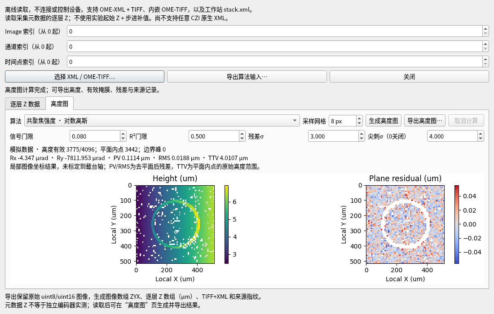
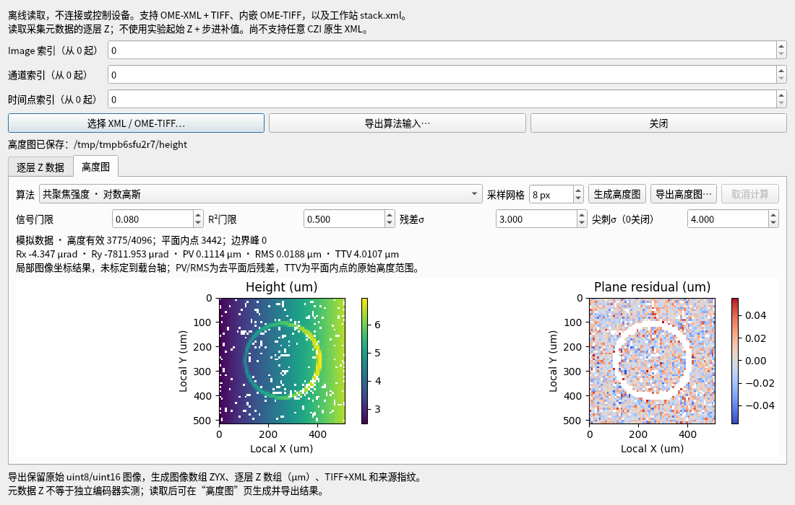
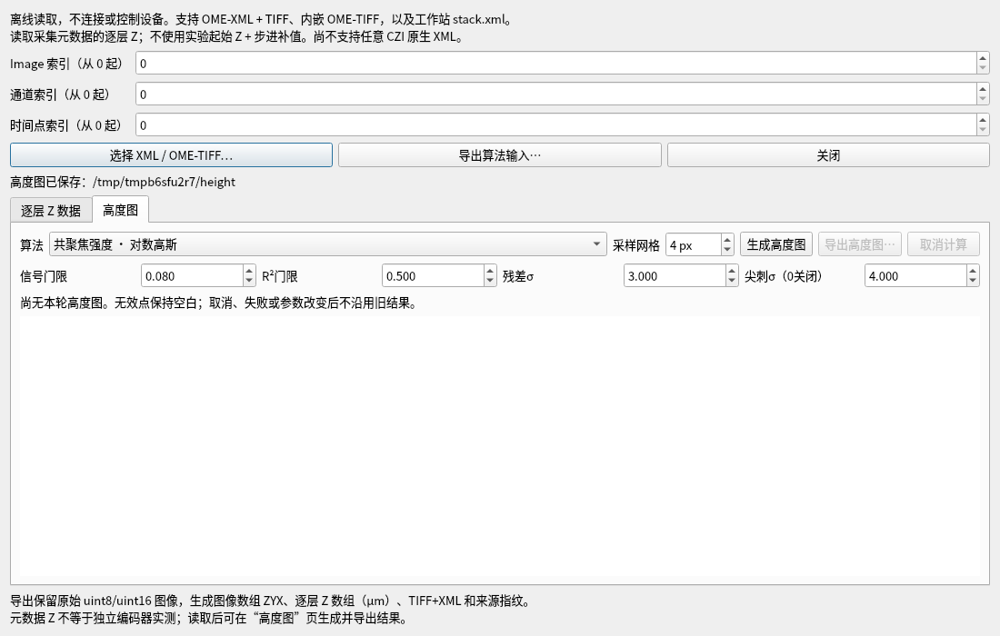

# Z-stack 高度图生成

读取堆栈后，可直接生成、查看及导出高度图，不再只输出算法输入。本轮只做本地后处理，不改变设备采集、AF、配方放行或生产测角行为。

## 使用

1. “硬件单步调试 → Z-stack 高度图…”选择配套XML或OME-TIFF。
2. 读取通过后自动打开“高度图”页。默认共聚焦强度对数高斯、8px网格；点击“生成高度图”。
3. 左侧显示绝对Z高度（µm），右侧显示平面内点残差（µm）；空白是无效/排除的数据，不填补。
4. “导出高度图…”输出高度、平面、残差、质量图及掩膜TIFF，NPZ数值数组，和带来源指纹、参数、统计量的JSON。原有“导出算法输入”仍独立保留。

原有在线Z-stack配方步骤产生`stack.xml`，在本入口选择该文件即可后处理。本轮尚未增加采集结束自动计算、配方高度图步骤、多面逐像素相减或3D视图。

## 算法来源与边界

使用用户指定的 [imbingo/z-stack-analysis](https://github.com/imbingo/z-stack-analysis/tree/e52d1211d794d6daa920c3e4df364900e47706c5)，固定提交`e52d1211d794d6daa920c3e4df364900e47706c5`（V3.2.2）。

`zen_topography_core.py`提取自其`zstack_focus_analyzer.py`，原文件SHA256：`4667db9661deb9633dabc1f60528c29a988086ed5e1da5b9e04cbebea8d463f0`。

保留以下数值函数体，未引入原工具的GUI、中心识别或独立文件排序：

- `normalize_to_255`
- `_score_image_for_topography`：原始共聚焦强度或局部Laplacian/Sobel清晰度能量。
- `_fit_height_maps_vectorized`：离散峰附近三点抛物线／对数高斯亚层定位及R²。
- `_spatial_spike_mask`：局部中值、MAD及小连通域尖刺筛选。

工作站适配层`zen_topography.py`使用已经验证的逐层Z及灰度数组；图像不经逐张归一化后再做共聚焦强度比较。网格按原工具的`ceil(size/grid)`及INTER_AREA面积平均；清晰度模式保留原工具的逐层归一化和高频能量定义。对数高斯是三点局部近似，不是完整非线性高斯曲线拟合。

与原工具整条流程的明确差异：

- 使用XML/API逐层Z，不依赖手填起始Z和步进。
- 等距要求：原亚层插值用统一dz，故亚层模式仅接受近似等间距数据（rtol=1e-4，atol=1e-8µm）；非等距可显式选择离散峰值，绝不自动切换算法。
- 共聚焦／清晰度曲线的动态范围须超过全局动态范围×信号门限，且大于数值噪声；默认比例0.08。原工具对部分弱信号只限制融合，本版进一步限制测量高度。
- 峰在首末层一律无效，不把扫描边界当真实表面；不做最近邻填补。
- R²门限>0时，无有限R²也剔除；离散/抛物线没有R²，非零门限会明确报错。默认0表示不启用R²筛选，并不证明曲线单峰或测量准确。没有新增专门的饱和/多峰识别。
- X/Y像素尺寸独立使用，不把两个方向都当作同一尺寸。过滤后必须有至少三个非共线点；过滤导致几何不足直接失败。
- 网格内原始高度、质量有效掩膜与平面拟合内点分别保存；nσ迭代滤波只控制平面拟合/残差统计，避免把真实特征抹成平面。
- Rx/Ry使用µrad，沿用源工具的局部左手显示系：X向图像右、Y向图像下、Z向下；Rx=atan(dZ/dY)，Ry=−atan(dZ/dX)。图像坐标尚未标定到设备XY轴，不能直接替代生产测角结果。
- PV为平面内点残差的峰谷差，RMS为其均方根；TTV为平面内点原始高度范围。拟合完成不是规格判定Pass。

## 输出与任务状态

- `height_um.tif`：float64绝对Z，NaN代表无效，不是0；`valid_mask.tif`提供高度有效性。
- `plane_um.tif`：拟合平面；`residual_um.tif`：所有高度有效点相对平面的残差；`inlier_mask.tif`控制平面统计，界面残差仅显示内点。
- `boundary_mask.tif`、`r2.tif`、`confidence.tif`：边界峰与算法质量图。R²、confidence是算法指标，不是已标定测量不确定度。
- `mip.tif`：保持原始XY分辨率和位深的最大强度投影，不称作高度图。
- `height_data.npz`：高度、平面、残差、掩膜、质量图和网格中心X/Y及采样Z数组；所有长度单位µm。
- `result.json`：原始元数据SHA256、图像页与SHA256、算法来源提交、全部参数、模拟标识、坐标定义和统计量。

估算计算工作内存超过512MiB会提示增大网格；不自动降采样或更改参数。计算不阻塞界面，可以请求取消；取消等待当前向量化计算段结束。参数变化、读取新数据、失败或取消不会保留旧高度图。写出先用临时目录，全部成功后才公开完整结果，不覆盖已有目录。没有真实设备动作，取消不是硬件停止。

## 验证

1. 数值核与上游固定提交直接运行生成的golden NPZ对照，height/R²/sigma按1e-12容差一致。夹具位于`tests/fixtures/topography/upstream_gaussian.npz`，源是上游函数本身，非本版函数生成。
2. 已知高斯表面、独立XY像素尺寸、µrad符号、四种模式、反向Z、非等距限制、弱/边界信号、常量堆栈、取消、NaN导出、磁盘失败清理及Qt实际生成/导出/参数失效/取消迟到结果均有自动测试。
3. 实际运行上游`demo_zstack`（10层512×512模拟PNG，按上游测试显式设Z=0…9µm、XY=1µm；无损转为TIFF并生成模拟XML）：grid=8、R²=0.5、残差σ=3、尖刺σ=4时，有效3775/4096、平面内点3442，Ry=−7811.953µrad，与上游黄金测试−7.812mrad±0.12mrad一致。PV=0.111351µm，RMS=0.018819µm。这是模拟算法验证，不能视为实机精度证明。

实际Qt运行截图（1100×700）：

未连接真实设备。现场表面信号、实验设置、采样密度、轴向响应、像素标定及最终几何精度仍须验证。
