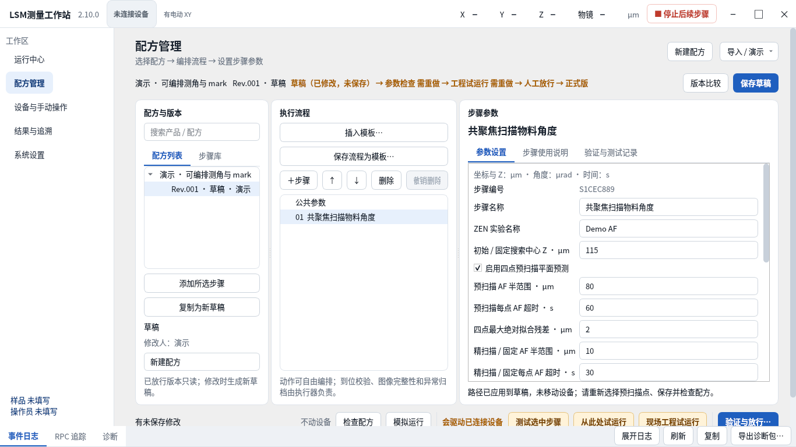
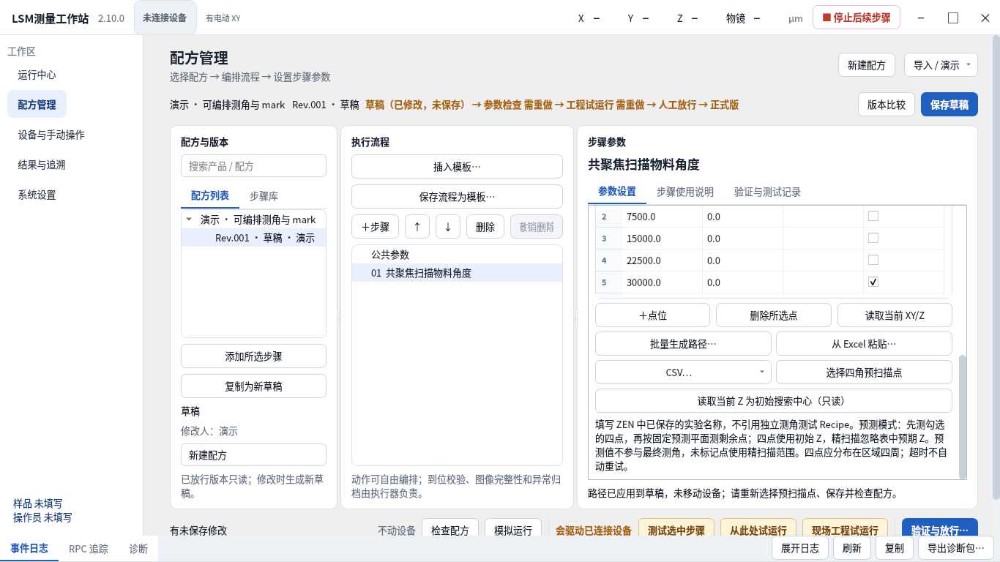
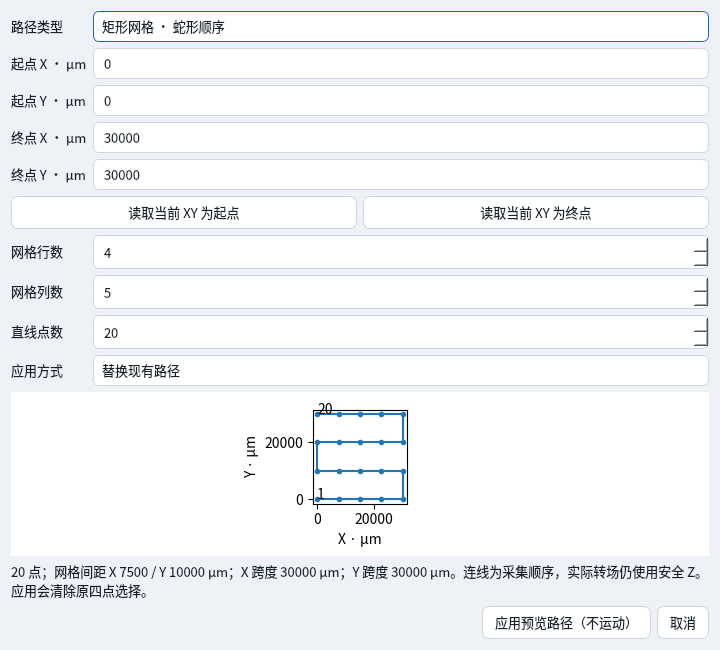
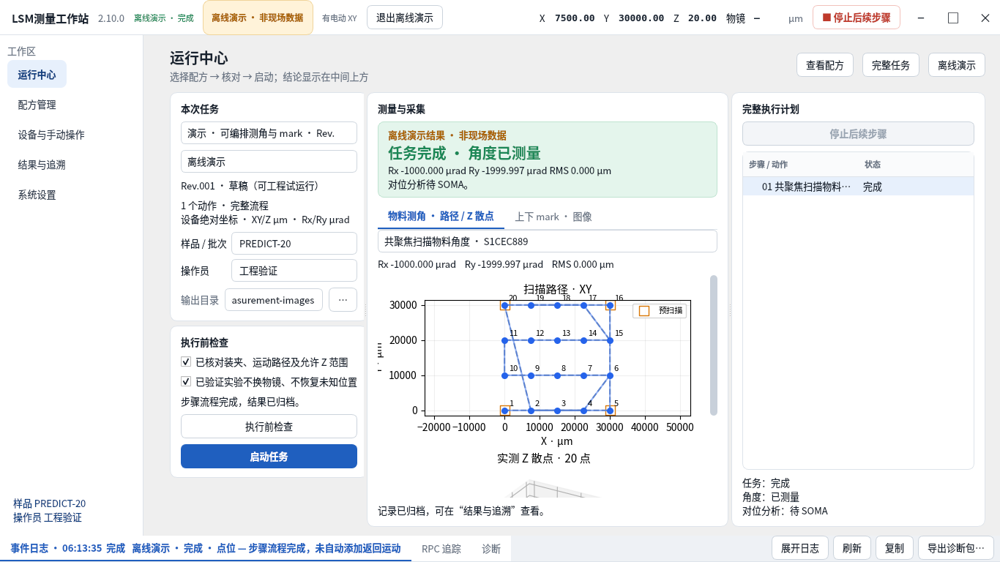

# V2.10.0：四点预扫描与平面预测 AF

在“共聚焦扫描物料角度”步骤内启用，不引用“独立测角测试”的 Recipe。ZEN 实验名称填写 ZEN 中已保存的实验名称。旧配方默认保持固定搜索中心模式，不自动启用预测，也不迁移成预测结果。

## 配置与执行

1. 在草稿中配置路径，勾选“启用四点预扫描平面预测”。
2. 从路径中勾选恰好四个预扫描点。四点必须 XY 不重复、非共线，建议位于测量区域四周；网格可点“选择四角预扫描点”。四角以外或内部局部翘曲仍可能预测不准，不能用残差检查保证全区域平整。
3. 填写或只读示教“初始 / 固定搜索中心 Z”。分别填写预扫描 AF 半范围/超时和精扫描 AF 半范围/超时，配置四点最大绝对拟合残差上限。示教不运动；预测模式不使用表格中的逐点预期 Z。
4. 保存并检查。首次四点使用初始 Z 与预扫描范围，按它们在路径中的相对顺序测量。拟合采用实际读回 XYZ，模型 `z=a·(x-x0)/s+b·(y-y0)/s+c`，全部单位 µm。预测平面在本轮固定，后续点不更新它。
5. 四点残差通过后，先检查全部剩余点的预测中心±精扫描半范围都落在允许 Z 范围内，再按原路径顺序测剩余点。每点仍经历安全 Z 转场、XY 到位、搜索中心 Z 到位、稳定和 AF。
6. 四点不重测；20 点路径正常仍是 20 次 AF。最终拟合使用全部实际 Z，不使用预测值替代测量。

预扫描失败、平面退化或残差超限、搜索区间越界、精扫描 AF 失败都停止后续步骤并保留已有记录。不自动扩大范围重试；停止不自动回程。预测 Z 不替代独立安全转场 Z。未知状态仍使用既有恢复检查。

`sequence.json` 保存预测模型、归一化原点与尺度、四点残差；每个实际测点保存原路径编号、实际执行序号、阶段、搜索中心、半范围、超时、实际 Z 与预测偏差。AF 流程耗时包含该流程内的 Z 定位、参数准备和读回。运行中心用方框标出预扫描点，连线按四点优先后的执行顺序显示；散点仅含本轮实测数据。

## 批量路径

- **矩形网格**：输入两对角设备绝对 XY（µm）、行列数，按蛇形生成。4×5 即20点。支持只读示教起终点。
- **直线均布**：输入起终点和点数；整条直线共线，不能单独用于拟合 Rx/Ry，可用于点位循环或追加后形成二维路径。
- 先预览跨度、间距和执行连线，再明确选择替换或追加。替换/追加都会清除原四点选择，要求重新确认。追加时检查重复 XY，总点数最多1000。
- **Excel 粘贴**：两列 X/Y 或三列 X/Y/Z，制表符或逗号分隔，单位 µm。空 Z 合法，空 XY、非数字、非有限数或重复点拒绝应用，不部分写入。
- **CSV 导入/导出**：导出带 `X_um,Y_um,Z_um` 单位表头；导入识别此表头，也支持无表头数据。导入前显示文本确认；其他未知表头不会被静默跳过。
- 所有生成、粘贴、导入、选择与预览只修改草稿，不触发运动或采集。正式版须复制草稿再改，检查/完整现场试运行/放行要求不变。

## 模拟截图（1366×768，Linux Qt offscreen）

以下数据为模拟，不代表真实设备接口或计量精度验收。图中的80 µm预扫描半范围用于模拟器的斜面示例，不是现场推荐默认值；精扫描示例为±10 µm。

验证覆盖：四点优先/每点一次、独立两阶段范围和超时、失败/停止/越界不继续、残差门槛、最终实测值与预测分离、大绝对坐标归一化、生成/粘贴/只读示教及参数保存。无真实设备运动。现场首次使用需宽范围验证四点初始焦面，检查精扫描成功率及边界余量，再确定范围。Windows构建结果以PR关联Actions为准。
