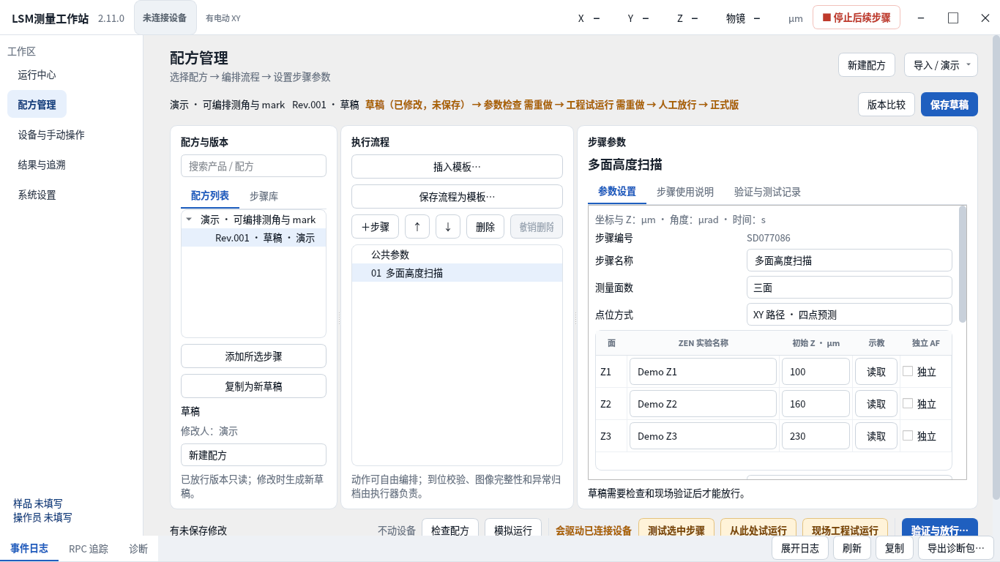
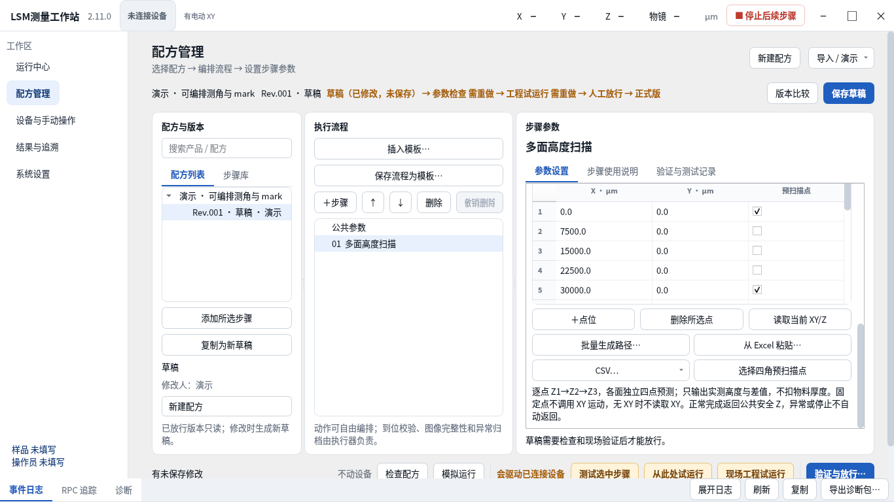
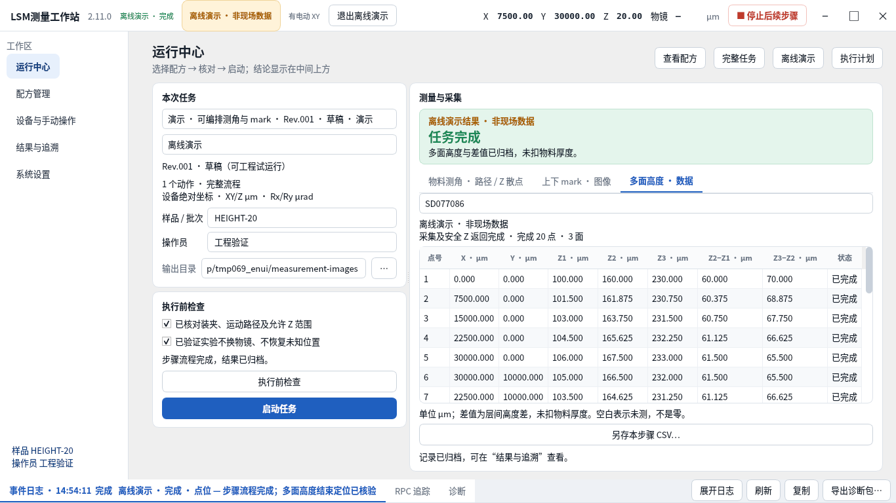
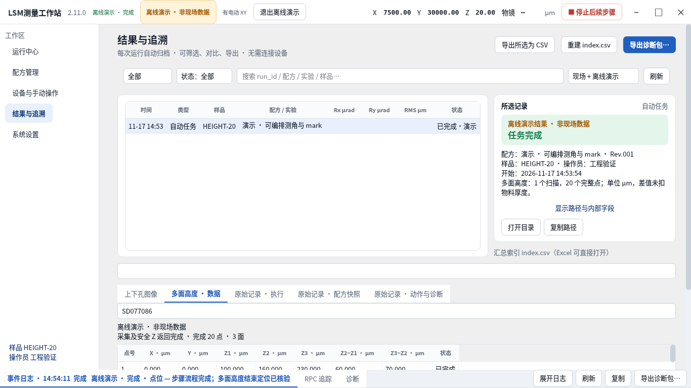
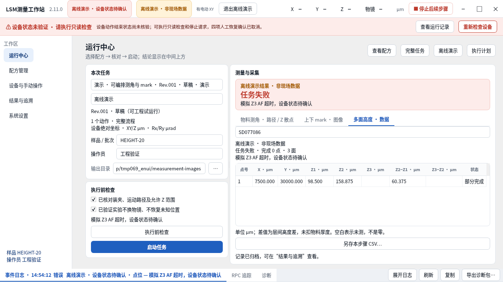

# V2.11.0 多面高度扫描（工程预览实现）

基于 PR #4 的四点预测能力，新增独立的“多面高度扫描”步骤。保留原单面角度扫描入口，内部复用运动、AF、四点几何验证和固定预测模型。

本版只采集高度与有符号差值，不接入 Doubleside，不扣单片厚度，不计算角度，也不把差值标成胶厚 VIG。设备向下 Z 增大；三面正常顺序为 Z1 < Z2 < Z3。按已验证场景直接使用 Z 读回，不增加折射率换算。

## 操作

1. 新建或复制为草稿，添加“多面高度扫描”，选择两面或三面，默认三面。
2. 在面配置表中填写每个面的 ZEN 实验名称和初始 Z（µm），也可以在 ZEN 手动对焦后点对应面的“读取”。该按钮只读 Z，不读 XY、不加载实验、不运动。真实配置不提供实验名或初始 Z 默认值。
3. 共用范围默认为预扫描 ±30 µm、精扫描/单点 ±10 µm；“更多 AF 设置”提供共用超时（60/30 s）及四点最大绝对拟合残差上限（2 µm）。这些只是可编辑的工程初值，不是实机推荐参数。需要独立设置时勾选该面的“独立”，展开覆盖值；关闭覆盖则使用共用参数，保留覆盖值供下次编辑。
4. “XY 路径 · 四点预测”复用批量生成、Excel粘贴、CSV与四点选择。指定恰好四个非共线、XY不重复的预扫描点，各面都测这四点。路径替换/追加清除原四点选择，需重新核对。
5. “固定当前位置 · 单点”不预测、不移动 XY；有 XY 时读回并核验保持同点，无 XY 时完全不读、不写、不查 XY 状态。此模式直接使用各面的初始 Z 和精扫描/单点范围，X/Y未知时写空值，不伪造0。
6. 配置公共允许 Z 范围、安全 Z、到位容差和稳定等待，保存、检查，在运行中心完成两项确认后启动。正式版本继续要求完整现场试运行、全部启用面实验指纹和人工放行；模拟或部分成功不能放行。

## 执行与状态

- 预扫描点按原路径相对顺序先测，每点按 Z1→Z2→Z3（两面止于Z2）加载相应实验、Z定位、稳定、AF。实验加载保留现有位置及可读光学配置核验，不能假设实验加载绝不运动。
- 各面使用四点实际 XYZ 独立拟合固定预测平面；全部模型残差和所有剩余点的完整搜索区间均通过检查后，才进入精扫描。到达实际 XY 后还会再次检查当前预测搜索区间。
- 剩余点按原路径顺序测量，四点不重复测；20点三面成功为60次AF，两面为40次。各面实验可不同，共用路径即可复用点位，但本版不输出角度。
- 每点以到位后的实际 XY 建立基准，每次加载/AF前后检查相对此基准的累计偏移，不能通过逐次小漂移绕过同点要求。
- 每面成功后即时、原子保存 JSON/CSV。未知AF状态、超时、停止、范围/残差/顺序异常及保存失败都阻止后续动作，不自动扩大范围、不自动重试、不补预测值或历史值。
- 正常采齐后返回公共安全 Z，确认到位后才报告任务完成。若返回失败，已采数据保留，明确显示“数据已采齐，结束定位未完成”。异常和停止不自动回程。
- 差值保持有符号原值；面顺序不满足递增时，保留已测高度和负差值，标记异常并停止。Z3失败时保留Z1、Z2、dZ21，Z3及dZ32留空。

## 输出与追溯

界面主列：X、Y、Z1、Z2、Z3、Z2−Z1、Z3−Z2，单位µm；两面模式省略Z3和第二组差值，另附点号及状态。显示按原点号排列，CSV按实际执行顺序写入，点号保持原路径编号。

CSV字段为 `point_no,X_um,Y_um,Z1_um,Z2_um[,Z3_um],dZ21_um[,dZ32_um],status`。`complete/partial/stopped/invalid_order` 分别表示完整点、部分点、停止、顺序异常；空值表示未测，不能当0。数值均为实际位置/高度或其直接差值。

每个步骤/循环实例独立归档：运行记录下 `height_scans/<路径哈希>/heights.json`、`heights.csv`；输出目录同时保存 `heights_<路径哈希>/` 副本，并纳入完成时的文件清单。文件按每轮唯一运行编号隔离，不覆盖其他任务。

JSON包含：实际执行序号、阶段、各面XYZ读回、实验名称与原始内容指纹、加载副本ID、AF后当前实验ID（AF准备可能再次Clone）、有效搜索中心/范围/超时、实际Z、预测误差、耗时、模型、残差和错误。AF流程耗时包含Z定位/参数准备/AF/读回，不包含此前实验加载。模型只帮助找焦，不替代高度数据。

运行中心和结果追溯新增“多面高度·数据”，可以另存本步骤CSV；采集中不开放另存，避免与Windows原子归档替换发生文件访问冲突。高度页自动收起执行计划以留出表格宽度，可通过顶部“执行计划”按钮展开；全局停止入口仍可用。

## 实际模拟截图

以下是本轮 Linux Qt offscreen、1366×768 截图，全部为模拟数据，未向真实设备发指令。

测试覆盖：两/三面、60/40次AF、独立模型与参数覆盖、固定点无XY、同点累计漂移、错面/负差值、模型及范围失败、保存失败、停止、返回失败、AF二次Clone的ID追溯、草稿保存、迟到示教响应、数据切换清空、放行证据。旧测角预测回归保持通过；Windows结果见关联PR的Actions。

实际ZEN接口能力、实验加载行为、各面AF质量/重复性、首次搜索范围与物镜间隙仍需现场验证。软件停止不是硬件急停。尚未自动合并或发布Release。
