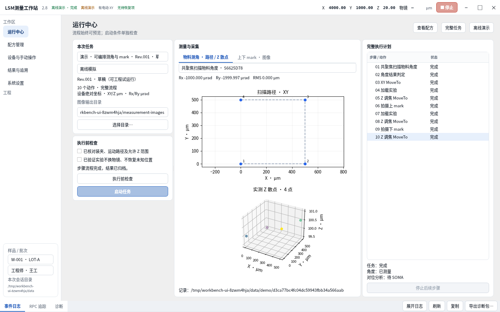
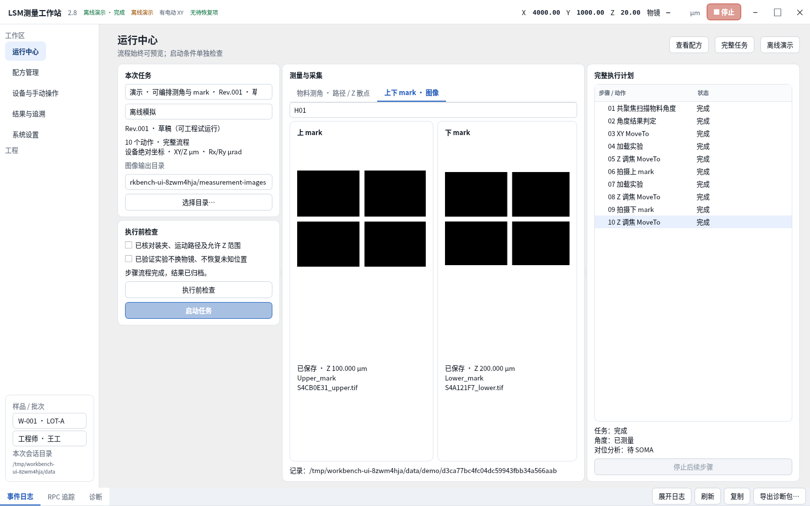
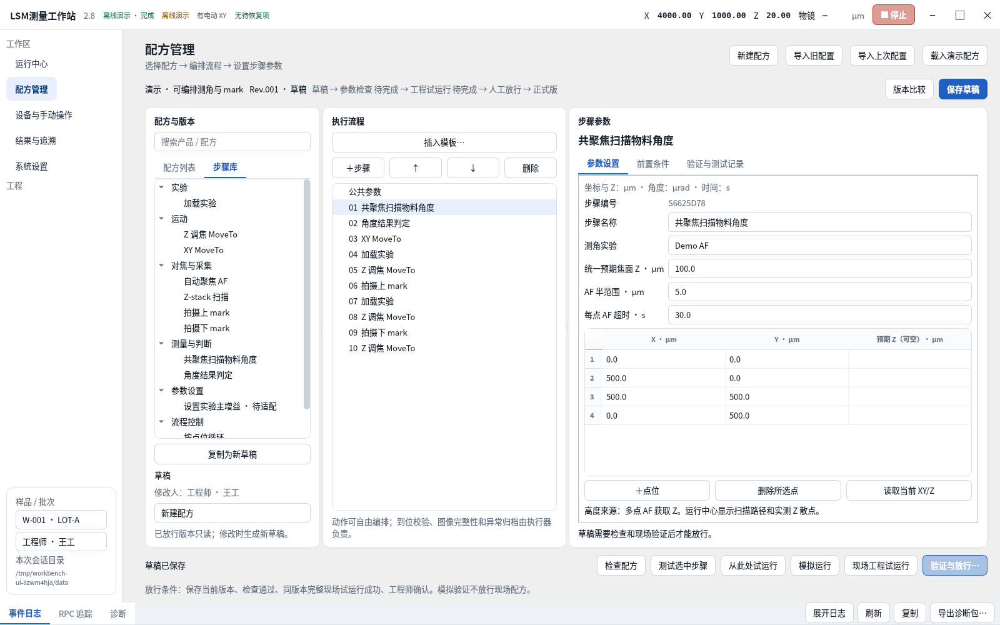

# LSM测量工作站 V2.8 · 工程步骤编排

本版把 V2.7 的固定“测角、孔位”模板改为参数化、有序执行的步骤程序。图中的数据均来自离线模拟设备，不能作为真实显微镜接口验证证据。

## 界面和操作

- 主窗口实际使用 `FramelessWindowHint`，自绘标题栏提供最小化、最大化/还原、关闭；标题空白可拖动、双击切换最大化，边缘启动系统缩放。关闭仍遵守任务与未保存草稿处理。
- 名称为 **LSM测量工作站**；安装包、快捷方式和窗口同步改名。保留旧 AppId、安装目录和 `%LOCALAPPDATA%/ZENSurfaceTilt`，便于升级保留配置。
- 配方管理左侧可切换“配方列表 / 步骤库”，中间添加、删除、排序步骤，右侧编辑当前动作参数。模板只插入初始步骤，之后均可修改。
- 配方状态路径为：**保存草稿 → 检查配方 → 完整现场工程试运行 → 工程师人工放行 → 正式版**。模拟运行和单步测试不能放行正式配方。修改已放行版本须复制为新草稿。
- 运行中心始终预览已选择配方；未连接、参数未填、草稿或能力不足只阻止启动，不清空步骤列表。
- “测试选中步骤”只执行测试范围；依赖实验的采集/AF/扫描会在计划中显式列出前置加载。测试 Z/XY 动作不隐式加载实验。“从此处试运行”重新编译当前范围，缺少本次结果引用会拒绝启动，不读取旧任务结果续跑。循环内不能作为中途起点。

## 测量与采集的两个 Tab

1. **物料测角 · 路径 / Z 散点**：上图显示当前测角步骤的有序 XY 点位、序号和已完成点；下图显示逐点实际采集的 XYZ 散点，Z 单位 µm。每个点完成后更新，显示 Rx/Ry（µrad）及 RMS（µm）。选择新配方或启动新任务时清空旧数据。图中的未测点不会被补为 Z=0。
2. **上下 mark · 图像**：按配对编号/循环上下文查看已保存的上下层 TIFF、实际 Z、实验名及文件名。预览拉伸仅用于显示，不修改原始 TIFF，也不进行 SOMA 对位分析。

## 步骤库及行为边界

| 动作 | 人工配置 | 运行行为 |
|---|---|---|
| 加载实验 | ZEN 实验名称 | 加载、记录 XML 指纹、创建独立副本；前后位置/物镜读回检查 |
| Z 调焦 MoveTo | 绝对/相对 Z、超时 | 仅移动调焦 Z，稳定读回后完成；不操作物镜转盘 |
| XY MoveTo | X/Y、转场 Z（可继承）、超时 | 先确认转场 Z，再执行 XY 并等待到位 |
| 自动聚焦 AF | 中心（空=当前）、半范围、超时 | 需要此前加载实验；范围写入读回、AF 结果及实际 Z 校验 |
| Z-stack 扫描 | 起止 Z、间距、超时、输出名称 | 独立多层流，完整校验后逐层保存 TIFF 与 `stack.json`；不收敛成单层 |
| 共聚焦扫描物料角度 | 实验、统一/逐点预期 Z、AF 范围、点位表 | 多点转场、Z 定位、AF 读取高度、拟合角度、返回公共转场 Z；实时图表 |
| 上 / 下 mark | 共焦/相机、超时、配对编号 | 对当前位置采一层图像；不会隐式移动、AF 或另选实验 |
| 角度结果判定 | 前置测角步骤 ID、Rx/Ry/RMS 阈值 | 不合格则停止后续流程，保留结果 |
| 按点位循环 | 点表、子动作 | 提供 `@point.x_um / y_um / z_um`，按行执行子流程 |
| 等待稳定 | 秒数 | 可停止的等待 |
| 设置实验主增益 | 通道/探测器、增益值 | **待接口适配**：允许编辑草稿，禁止检查通过或执行；不冒用相机曝光接口 |

数字参数可引用本次运行中此前步骤的输出，例如 `@S123ABCD.z_um`。不会执行 Python 表达式，也不会使用历史任务的结果。引用和循环依赖在启动前重新检查。最多两层循环、1000 个声明步骤和 10000 个展开动作。

公共参数保存允许 Z 范围、转场 Z、XY/Z 容差及稳定时间。坐标为设备绝对坐标；软件没有实现自动装夹坐标转换。无 XY 设备可运行仅依赖 Z/实验/采集的程序，测角及 XY 动作会被逐项拒绝。

## 数据、恢复和兼容性

每次任务冻结配方版本/哈希、操作员、样品、检查读回；归档 `snapshot.json`、`sequence.json`、`command_log.json`、测量点、图像清单与 SHA256。运行中心及记录页统计新版图像，图像目录仍独立于中央记录目录。失败保存已完成的数据，涉及动作的状态不确定时保持恢复锁，不自动重试、跳过或回程。

Z-stack 使用既有官方 ZStackService 版本适配层；单层 mark 仍使用现有单层采图接口。新扫描通路要求完整平面、实际每层 Z、层数/几何/采集状态一致，限制 4096 层和 512 MiB。额外通道、拼图、时间序列、重复或缺失平面均拒绝当作成功。

ZEN 3.12 的服务包名差异仍由既有反射/适配层处理；版本号不能证明所有功能可用。当前实机未注册的 AF、转盘或增益接口不会凭空获得支持。转盘位置不可读时仍显示未知，不能声称已锁定。

V2.7 原配方保留，编辑时将其复制为显式步骤模型；旧正式版本须复制草稿、保存新步骤、重新完成现场验证后用于新版正式运行。旧版后端入口保留以支持历史记录和回归验证，不再作为新版运行中心的执行器。

## 验证方法

- `test_zen_program.py`：独立测角/孔位路径、无 XY、参数引用、循环、多层保存、判定中止、下层失败保留上层、Z 超时、检查后位置变化、恢复锁。
- `test_zen_stack_gateway.py`：官方 protobuf 本地 gRPC 服务，验证多层接收、缺层、重层、额外通道及无 XY。
- `test_zen_qt_program.py`：实际无边框标志、离线无效草稿仍预览、单步范围、从此处依赖校验、实测散点、新任务清空及增益阻止执行。
- 原核心/硬件/Qt 回归继续执行；Windows CI 执行安装和便携包检查，并在 100%、125%、150% 缩放下捕获真实运行界面。
- `capture.py` 只连接模拟设备，生成本目录截图。截图不是渲染图。真实显微镜运动、实验副作用和采集接口仍需现场按步骤验证。
