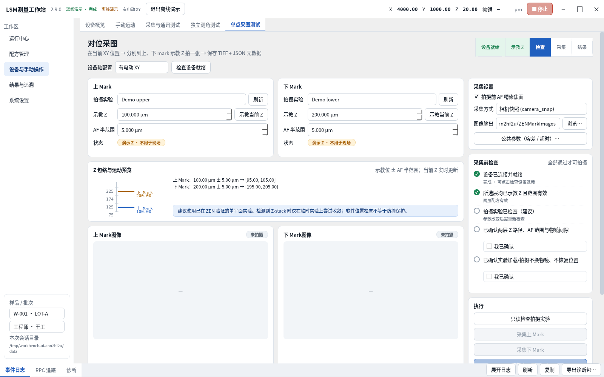
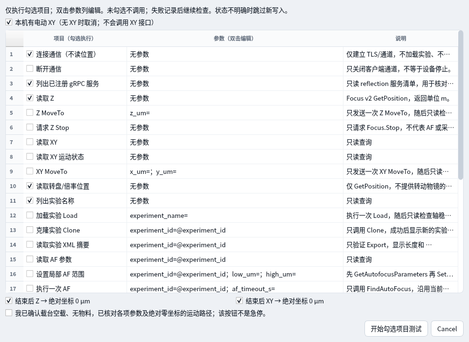
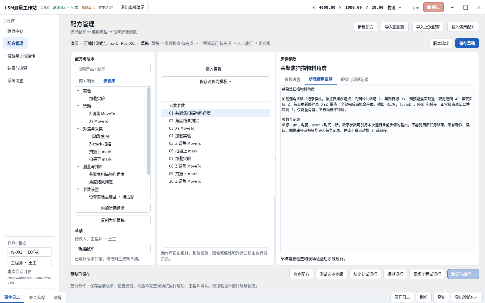

# V2.9.0 工程测试与配方编辑

本版针对无 XY 临时测试机、硬件批量测试和配方工程编辑。截图均由实际 Qt 程序运行生成，设备数据为模拟数据。

## Z 示教与轴配置

Z 示教仅调用 Focus 的 Z 读取，验证有限数字后填入所选层；不读 XY，不查询载台运动状态，也不要求先通过 XY 业务就绪检查。因此，即使误选“有电动 XY”，也能先读出 Z。

单点采图页增加显眼的“设备轴配置”。当前没有电动 XY 的测试机应选择“无电动 XY · 仅 Z”，随后重新连接。采图与批量测试按轴配置检查能力，不能把 XY 方法未提供一概判断为整台显微镜未连接。

## 硬件目录与一键测试

操作目录文字不再省略，按最长内容计算宽度，提供像素级横向滚动；分隔条可调整左右宽度。

点击“一键测试”后：

1. 勾选实际需要的项目；未勾选项不作为独立测试；已勾选动作仍包含必要的只读到位和状态验证。按设备实际情况设置本机是否有电动 XY。
2. 双击参数列编辑各项参数。`@experiment_id` 使用本批次 Load/Clone 的返回值；`@camera_id` 使用本批次列出相机的第一个 ID。缺少前置结果会记录该项不 OK，不会拿历史会话 ID 凑数。
3. 核对空载、无物料、测试参数和运动路径后集中确认。可分别选择结束后 Z 和 XY 移到绝对坐标 0 µm；这不是设备寻原点，不调用 InitializeStage，也不伪造 Focus Home 接口。已经在零位时不重复发送相同位置 MoveTo。
4. 按清单顺序执行；失败和不支持的方法写入报告，继续后续检查。断开通信放在最后执行。采图输出名附加批次后缀，避免 SNAP 和实验采集使用同名输出。
5. 点击“请求停止”后不再执行剩余测试及回零。它是软件停止请求，当前同步 RPC 仍可能需要等待返回或超时，不是硬件急停。
6. 结束后界面显示逐项结果和建议，可导出 Markdown 或 JSON；原始报告保存在 `hardware_batches/<批次>/report.json` 和 `report.md`，各操作仍有 RPC 日志。

结果明确区分 OK、不 OK、不适用、未勾选及停止后未执行。无 XY 的设备不发送 XY 请求。动作超时或结束状态未知时，只读检查继续；新的写入先进行只读状态验证，仍无法确认时记录不 OK 并跳过，避免未结束动作与新运动叠加。

## 取消恢复确认

当前 Qt 产品入口不再使用四项人工恢复问卷，也不以历史未确认文件阻止新会话。旧错误记录保留，既不删除，也不伪造“已人工确认”的记录。

动作报错后仍会显示当前状态未核验，使用“检查设备状态”读取实际位置和实验状态。正在运行或状态无法读取时，不能把它显示为就绪。批量测试采用相同的实时写入检查，不能通过新建硬件日志会话绕过未核验的动作状态。

单次写入前的操作确认、拍摄前对 Z 路径/实验行为的核对，与恢复问卷是不同用途，仍保留。空载批量测试使用一次集中确认。

## 配方工程操作

- 右键配方名称或任一版本，选择删除配方。整套配方从可选列表移除；历史运行快照与版本证据保留，不改写已发生的测量记录。任务执行中不能删除。
- 用鼠标拖动步骤排序，也可在点位循环内调整子步骤；公共参数不可拖动，普通动作不能接收子步骤。拖动后再编辑参数会写入实际配方模型，启动时仍检查引用顺序。
- 点击“保存流程为模板”，保存当前完整步骤、参数、公共参数、坐标声明和演示标志。下次启动可从“插入模板”选择。插入时生成新步骤 ID 并重新关联内部结果引用；已有流程仅追加步骤，空白配方同时载入公共参数。演示模板不能借此变成现场配方。
- “前置条件”页改为“步骤使用说明”，逐步解释发送哪些动作、哪些动作不会隐式发生、参数意义、输出文件与失败行为。
- 左侧“工程”原来只是没有功能的空分组标题，已删除；工程测试仍位于“设备与手动操作”的标签页中。

## 验证范围

新增后端测试覆盖勾选隔离、无 XY、失败后继续、停止、零坐标、未核验动作阻止叠加写入、实验 ID 传递、报告落盘、模板重启保存/引用重建及配方删除保留证据。新增 Qt 测试覆盖独立 Z 示教、目录滚动、拖动后的参数编辑、模板插入、删除后的空界面、实时检查替代问卷及批量选项入口。

实际显微镜的各接口是否实现、实验是否恢复硬件位置和空载运动路径，仍需现场核对。批量报告用于接口/动作测试，不代替测量精度验收。
