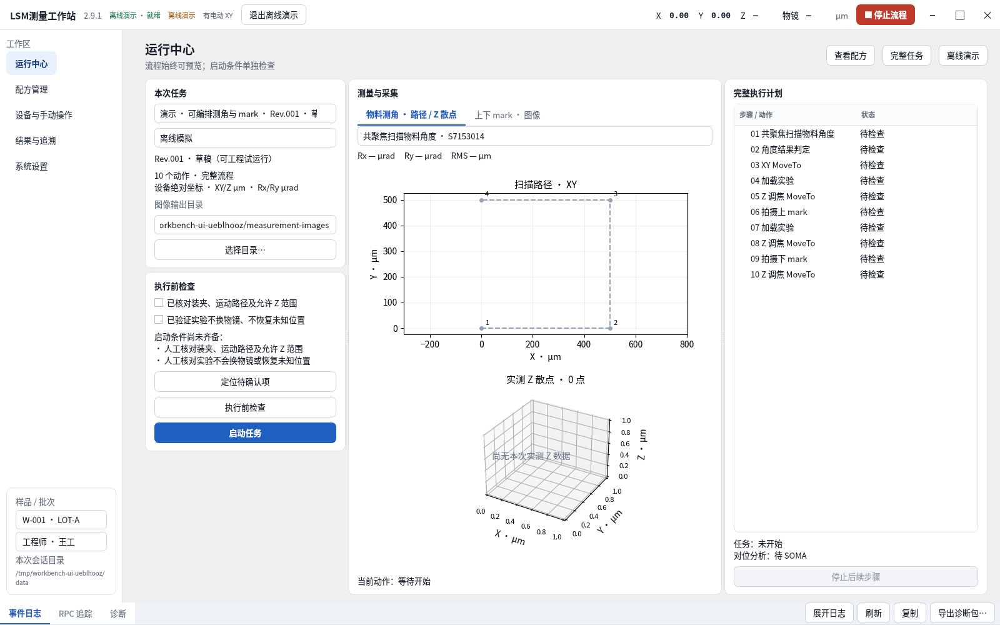

# V2.9.1 操作反馈改进

这版重点解决入口反复变灰、缺少条件却不知道如何继续的问题。

## 使用方式

- 运行中心的人工确认、执行前检查、启动任务保持可点击。点击后，缺少条件会直接列在按钮旁，并提供连接设备、编辑配方或选择目录等入口。
- 勾选必要确认后直接点击“启动任务”，软件会先自动执行只读检查，通过后执行一次任务。不必先找检查按钮再启动。
- 后台刷新位置不再让操作入口或人工确认反复变灰。显式点击优先于下一次周期刷新。
- 设备、手动运动、mark 采图、独立测角、硬件单步与批量测试的入口同样给出缺少条件的原因，避免无反馈。
- 草稿自动选择工程试运行；正式运行仍要求已放行版本。放行入口可点击查看全部缺项，正式版参数仍只读，需要复制为草稿修改。

## 确认与等待

路径和实验确认在同一配置下可以保留。修改输出目录或操作员信息不会清空这些确认；样品变化重置装夹与路径确认，配方、设备或执行范围变化则重新核对。

如果点击时恰好正在读取状态，页面会显示等待提示，读取结束后继续一次。点击停止、修改相关参数、切换页面、打开参数对话框或关闭窗口会取消等待请求。重复点击不会重复下发。

设备动作仍串行执行。实际任务执行期间不能叠加新运动，按钮会说明原因；参与当前任务的关键配置会冻结。坐标范围、到位校验、设备能力和配方放行条件仍由后台检查。这里的“停止流程”是软件停止请求，不代表硬件急停。

## 验证

新增 18 项针对性回归，覆盖缺项反馈、后台读取、自动检查、重复点击、停止、参数变更、页面离开、弹窗取消和检查后发生其他动作的重新校验。完整 Qt 回归为 75 项，核心与接口回归 138 项，另有 15 项旧 GUI 回归由 Windows 构建执行。

真实 Qt 界面截图通过模拟设备生成，不连接 Gateway，也不代表实机验收。

