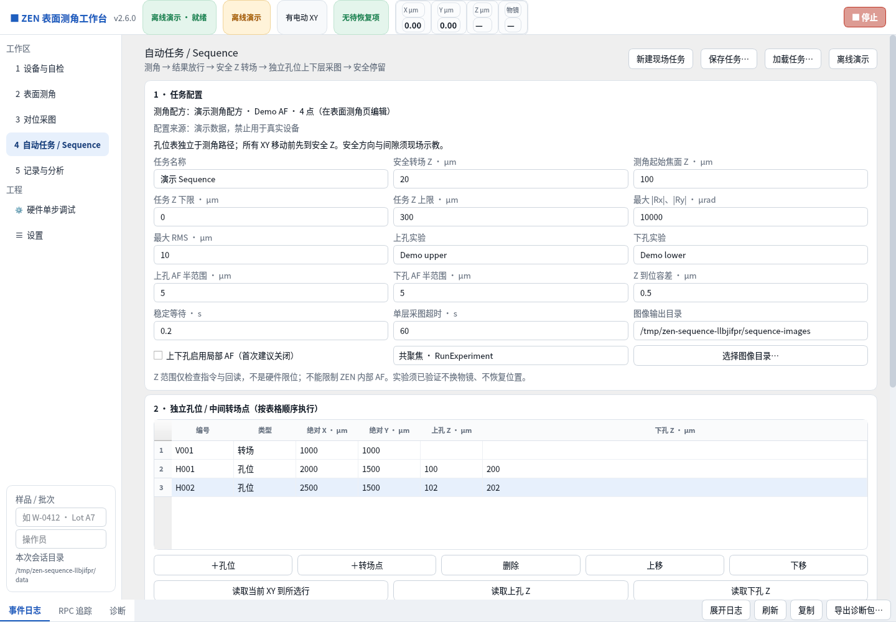
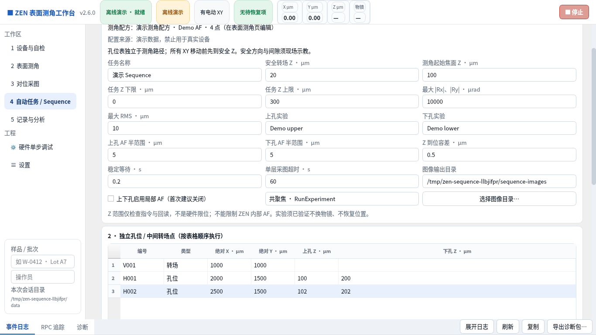
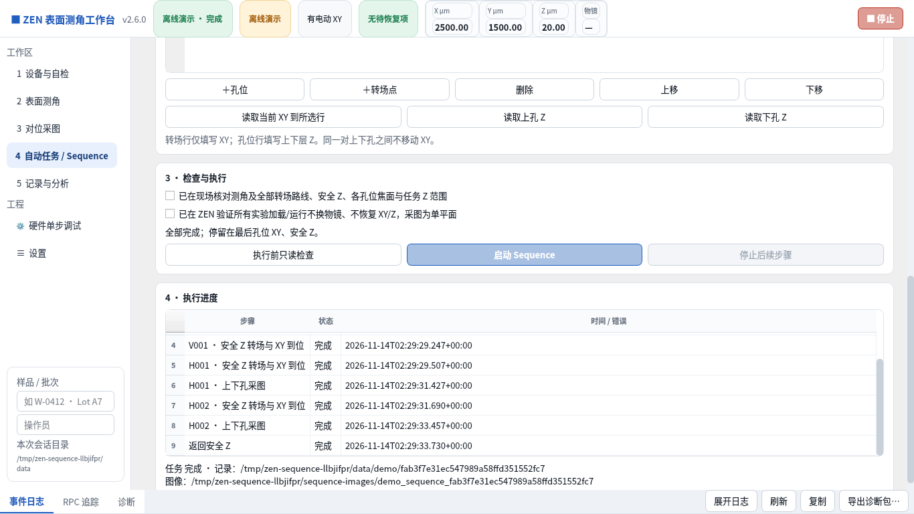
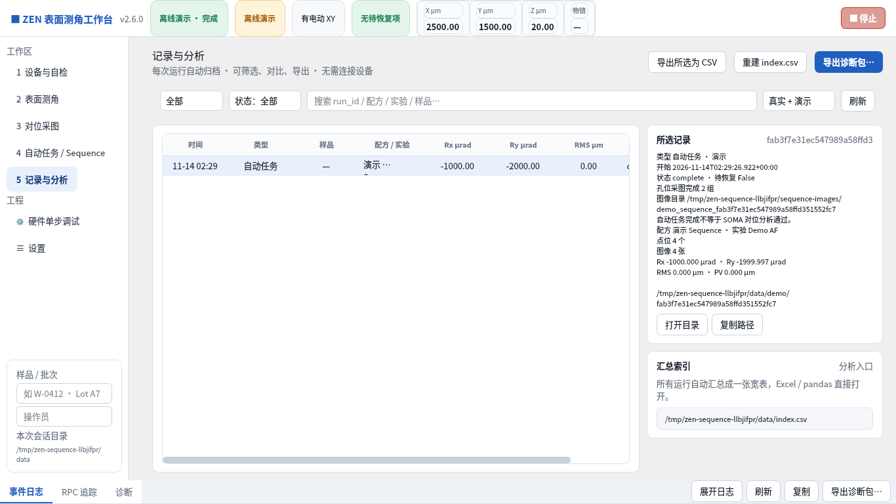

# V2.6.0 自动任务 / Sequence

新增 Qt 页面，将测角、独立孔位转场和上下孔采图串成固定流程。传统 Tk 页面仍使用原有独立测量流程。

## 如何使用

1. 在「表面测角」配置测角配方与 A 区点位。至少三个不共线点；现场须先完成当前点 AF 校验。
2. 打开「自动任务 / Sequence」，选择「新建现场任务」。填写任务名、安全转场 Z、测角起始焦面 Z、任务 Z 上下限、角度及 RMS 放行阈值。坐标与距离输入单位为 µm，角度阈值为 µrad。安全 Z 必须按实际设备示教，不能假定 Z 数值大或小就更安全。
3. 填写上孔、下孔实验与输出目录。上下孔可选共聚焦或相机采图；首次建议关闭局部 AF。上下孔实验应具有相同物镜、倍率、ROI、图像尺寸与像素标定，且为已验证的单平面实验。
4. 直接编辑独立孔位表。每行填写唯一编号、类型、绝对 X/Y；孔位行另填上孔和下孔 Z。类型可填写「孔位」或「转场」。转场行仅移动到该 XY，不拍照，适合绕过已确认的障碍物。支持增删、上下移动和读取当前 XY/Z 示教。
5. 孔位可以完全位于测角路径范围之外；它们不会加入测角拟合。孔位 Z 必须在该孔位分别示教，不从测角结果外推。
6. 执行前只读检查，核对起点、XY 空闲与 Z 范围。Gateway 设备还必须有已读取的必需服务清单；服务注册不证明每个方法或实验已通过实机测试。现场连接还要求此前的单点 AF 起点校验未失效。
7. 人工核对所有 XY 路线、安全 Z、孔位焦面及实验行为，勾选两项确认，再启动。任务提交后会消耗确认，并锁定编辑与其他设备任务。
8. 完成后按任务编号找到角度结果和逐孔 TIFF，交给 SOMA。软件不自动分析对位偏差，也不自动调平。

参数和当前测角配方会自动记忆；执行确认和只读检查结果不记忆。也可显式保存/加载完整任务 JSON。界面草稿使用 µm，测角配方快照及运行记录使用明确标记的 m。无效输入可保留为草稿，执行前必须修正。演示配置有来源标记，禁止用于真实设备，且不会覆盖已有现场配置。

## 固定执行顺序

```text
起点与设备检查
  → 加载测角实验，并检查是否意外恢复位置/改变光学读回
  → 每个测角点：安全 Z 到位 → XY 到位 → 测角起始 Z 到位 → AF → 回读
  → 平面拟合，检查 |Rx|、|Ry| 和 RMS
  → 按独立表格逐行执行：
      安全 Z 到位 → XY 到位
      转场行：继续下一行
      孔位行：上孔 Z / 可选 AF / 采图保存 → 下孔 Z / 可选 AF / 采图保存
  → 返回安全 Z
  → 完成，停留在最后表格点的 XY 与安全 Z
```

只在已确认的读回和状态通过后执行下一步，不靠固定等待时间猜测动作完成。安全 Z 到位要求连续稳定读回，XY 转场结束后再次核对 Z。实际 Z/AF 返回值超出任务范围、XY 偏移、读到的光学位置变化、实验准备恢复位置或接口失败都会停止后续任务。

任务 Z 范围是软件检查，不是硬件限位；它不能阻止 ZEN 内部 AF 或实验自身运动先越界。缺少转盘/倍率读回时仍记录为未校验，必须人工确认实验行为，不能据此宣称物镜已锁定。软件没有直接调用物镜转盘 MoveTo。

测角不通过放行阈值时，保存独立角度结果并停止，不前往孔位。不会自动调整姿态。

## 停止与恢复

「停止后续步骤」和顶部停止按钮只请求停止后续流程；同步设备 RPC 可能尚未返回。异常或动作中停止后：

- 不自动返回安全 Z，不自动重拍，不跳过失败孔位继续下一孔。
- 保留已完成的图片；例如下孔失败时保留上孔 TIFF，该组不标为完整。
- 记录任务失败阶段、错误、逐步状态、位置回读及 RPC 诊断，并保留恢复锁。
- 重连、重启不会自动续跑。须现场确认 XY、Z、AF、采集结束后记录恢复；重新连接、校验并明确启动新任务。

完成测角后仅因工艺阈值未通过而结束，不视为未知设备动作；仍不会自动返回或继续移动。

## 文件与归档

中心运行目录：`data/field/<任务编号>/`；演示为 `data/demo/<任务编号>/`。

- `recipe.json`：完整任务快照，包括测角路径、独立孔位、Z 和放行阈值。
- `points.csv`：测角逐点记录。
- `angle_result.json`：测角计算结果，后续采图失败时也保留。
- `result.json`：仅完整任务成功后发布的角度结果。
- `sequence.json`：总状态、步骤、各步骤位置回读、各孔位子记录和图片目录。
- `status.json`、`run.log`、`session.json`：恢复状态、全流程阶段日志及样品/操作员。
- `captures/<表格序号>/`：各孔位完整的采图子记录。

外部图像目录为 `sequence_<任务编号>/hole_<表格序号>/`，内含 `upper.tif`、`lower.tif`、`capture.json`；演示目录带 `demo_sequence_` 前缀。转场行占表格序号但不产生图片。根目录另存任务汇总 `sequence.json`。RPC 诊断沿用最多 256 条方法级记录，不含令牌、请求体或实验 XML。

记录页新增「自动任务」分类，汇总角度和图片数，并提供任务及图像目录信息。完成只表示流程与文件核验通过，不代表图像质量或 SOMA 对位分析已通过。

## 接口兼容与测试

- 为 XY 读写显式增加官方 ZEN 3.12 的 `zen_api.lm.hardware.v2.StageService` 反射路径，保持米制单位。新版本继续使用 `zen_api.hardware.v1.SimpleStageService`。不会误用另一套通用多轴 StageService。
- 新旧 XY 路径仅在方法明确未实现时切换；超时、授权或通信错误不会重发另一个 XY 写入。
- Z-stack 收敛参数写入仅在 UNIMPLEMENTED 或 INVALID_ARGUMENT 后尝试另一种参数形式，超时/通信/授权失败直接停止。
- 通用版本回退限制在同一服务家族，避免把 LM 相机误匹配到 EM，或把普通实验误匹配到 LLS 实验。
- 修正开机检查中旧 XY 路径误报，以及“注册了其他 AF 就已经自动降级成功”的不准确提示。

新增 8 项任务后端测试、5 项实际 Qt 交互测试、3 项接口回归测试。核心 69 项、Qt 23 项；Windows 构建另运行传统界面 15 项，共 107 项，并验证安装包安装后的运行时。自动测试包含全程互斥、独立区域、所有 XY 移动前的安全 Z、阈值拦截、下孔失败保留上图、停止、Z 超时、实验恢复位置、来源隔离和参数记忆。

这些是模拟与本地协议测试；真实显微镜的 AF 搜索、单层实验接受条件、机械间隙和 ZEN 3.12/3.14/3.15 的完整流程仍需现场验收。此前的 [V2.5.1 官方接口核查](../api-compatibility/2026-11-14/README.md) 保留为该提交的历史报告，本版修复了其中的 XY 路由与 Z-stack 回退问题。

## 实际运行截图

以下为 Linux Qt offscreen 实际运行、明确使用模拟设备的截图，不是 Windows 或显微镜实测。演示测角区域为 0–500 µm，孔位在 2000–2500 µm，故意不在测角路径范围内。演示完成 2 组孔位、4 张 TIFF，最终停在 X=2500 µm、Y=1500 µm、Z=20 µm；见 [运行结果](demo-result.json)。








