# V2.5.0 Qt 重构后功能与界面运行审查

**结论：核心模拟采集链路可运行，但 Qt 重构存在多项影响升级、无 XY 使用和恢复操作的回归，不能以当前冒烟测试通过作为完整功能验收。**

审查代码：[54b4395a629f1fb1b5017f5da7eec0b408cdd2ba](https://github.com/imbingo/zeiss-stage-control/tree/54b4395a629f1fb1b5017f5da7eec0b408cdd2ba)。本报告对应该提交，不代表未来提交的状态。

## 1. 范围与证据性质

- 本轮实际启动 `WorkbenchWindow`，使用 Qt offscreen 平台运行页面、按钮处理、Workflow、模拟设备及文件保存，调用窗口 `grab()` 保存原始 PNG；不是 HTML 设计稿、合成截图或仓库旧图。
- 使用 Python 3.12、PySide6-Essentials 6.11.1、项目依赖及固定官方定义生成的存根。截图在 Linux 渲染，使用本机 CJK 字体；Windows 的字体、窗口边框、DPI、原生对话框和图像插件可能不同。
- 测角与图像均来自明确的离线模拟设备，没有连接真实 Gateway、没有向显微镜发送指令。旧版 API 的线协议由本机 gRPC 测试服务验证，不能替代 ZEN 3.12/3.14/3.15 的实机验收。
- 字段编辑和按钮通过 Qt 控件及其真实回调执行；对无 UI 入口的无 XY 模式，另以偏好文件预设进入。这个预设测试不表示新版界面有模式选择入口。
- 截图中的路径是临时测试目录，日志时间来自执行环境 UTC，不是显微镜现场拍摄时间。
- 此提交仅保存报告、截图和测试证据，没有修复程序或发布安装包。

## 2. 实际运行结果

| 流程步骤 | 结果 | 证据/限制 |
| --- | --- | --- |
| 1. 首次打开设备页及连接设置 | 有问题 | 页面能打开，但没有可见的 XY 模式选择控件；截图 01、14 |
| 2. 正常四点测角 | 模拟通过，展示有问题 | 完成四点并显示 Rx/Ry、表格与曲线；演示配方标签仍显示未加载、步骤未正确切到结果；截图 02 |
| 3. 路径编辑 | 正常输入流程通过 | 添加保留输入、重排、删除、应用及 µm→m 换算通过；截图 03 |
| 4. 上下 mark 成对采图 | 模拟通过，预览受环境限制 | 两张 TIFF 和 capture.json 存在，`pair_complete: true`；本机 Qt 无 TIFF 插件，截图 05 显示预览不可用 |
| 5. 无 XY、无 AF 的成对采图 | 预置模式后模拟通过 | 不校验/伪造 XY，记录为未知；测角按钮禁用；入口缺失仍是独立问题；截图 15 |
| 6. 硬件单步 Load→Export | 有问题 | Load 返回 ID，切到 Export 后 ID 变空；截图 07、08 |
| 7. 记录页与汇总 | 有问题 | 识别测角/采图运行，但已保存两图被统计为 0，采图有效性语义不清；截图 06、16 |
| 8. AF 超时故障与恢复 | 锁定正确，恢复入口损坏 | 保留失败点、无有效角度、存在恢复记录；打开恢复确认弹窗报 AttributeError；截图 10、17及错误栈 |
| 9. 旧配置升级、设置与自动记忆 | 有问题 | 旧 Z 字符串导致启动异常；Qt 数值与输出目录被过滤，样品/操作员 session 也不保存 |
| 10. 小屏与可读性 | 有问题 | 1366×768 请求被限制为 1366×780；mark 字段、说明和路径明显裁切/重叠；截图 13 |

### 自动化与本轮探索检查

- 重跑 **55 项核心/接口测试：通过**，见 [core-tests.log](evidence/core-tests.log)。日志里的合成无效 CA 提示属于测试输入，不是连接现场失败。
- 重跑 **3 项 Qt 冒烟测试：通过**，见 [qt-smoke-tests.log](evidence/qt-smoke-tests.log)。
- 另外运行了页面与边界复现检查，包含实际文件核对、旧配置启动、参数往返、ID 生命周期、确认失效、恢复对话框、模式入口、图片索引和小屏布局；结果保存在下述 JSON 中。
- 这些探索检查的 `passed: false` 表示某项期望未满足，不是“所有正常采集均失败”，也不是新增了对应数量的正式 CI 用例。
- 现有 Qt 恢复测试直接调用 `window.confirm_recovery()`，没有创建 `RecoveryDialog`，所以没有覆盖弹窗创建错误。现有启动用例也只使用空白偏好目录，未覆盖旧配置升级。

## 3. 按优先级排列的问题

### R01 · P1：恢复确认弹窗打不开

**复现**：在模拟硬件 Load 后形成恢复锁，创建恢复对话框。

```text
AttributeError: 'PySide6.QtWidgets.QCheckBox' object has no attribute 'setWordWrap'
```

[dialogs.py:280](https://github.com/imbingo/zeiss-stage-control/blob/54b4395/zen_qt/dialogs.py#L280) 对标准 `QCheckBox` 调用了不存在的方法。红色恢复条能显示，后端也正确锁定，但用户无法通过这个 Qt 弹窗完成正常恢复确认。构造失败，没有可接受的弹窗截图，保留 [实际错误栈](evidence/recovery-error.txt)。

**建议**：用支持换行的独立 QLabel 或可用布局替代，补“实际点击恢复入口→逐项勾选→落盘→解锁”的界面测试。不要删除恢复文件或绕过现场确认来规避。

### R02 · P1：无 XY 模式没有界面入口

首次运行默认为 `motorized`。设备页提示“在连接对话框选无 XY”，但 [GatewayDialog](https://github.com/imbingo/zeiss-stage-control/blob/54b4395/zen_qt/dialogs.py#L33) 没有对应下拉框/单选项，顶部也只是标签；`set_xy_mode()` 没有从当前 Qt 页面连接到选择控件。

**影响**：新用户不能通过界面切换到无 XY。当前现场设备没有电动 XY，错误模式还会让正常连接先读 XY。已有 `xy_mode: no_xy` 偏好可以恢复，但不能作为缺少入口的解决方案。

**建议**：恢复模式选择并在切换时断开、清除确认与当前位置、要求重新连接。见截图 01、14、15。

### R03 · P1：旧版偏好可能使 Qt 启动直接失败

旧版保存的 Z 和半范围是字符串；[marks.py:265](https://github.com/imbingo/zeiss-stage-control/blob/54b4395/zen_qt/pages/marks.py#L265) 直接执行 `saved['z_m'] / UM`。

以合法旧配置中的 `z_m: "0.000019996"` 启动，实际得到：

```text
TypeError: unsupported operand type(s) for /: 'str' and 'float'
```

**建议**：做带版本的偏好迁移，验证有限数字，保留损坏原文件；回归测试必须包含带现场参数的旧 ui.json，而不只是空目录。不要要求用户删除全部历史数据。

### R04 · P1：参数改变、演示切现场后，安全确认没有失效

**复现**：勾选两项确认后修改上层 Z 与实验名，两项仍为 True；从演示切换为一个标记为现场的测试绑定后，演示 Z/示教标记和确认仍保留。整个测试没有使用真实硬件。

[marks.py:249](https://github.com/imbingo/zeiss-stage-control/blob/54b4395/zen_qt/pages/marks.py#L249) 和 [on_connect:494](https://github.com/imbingo/zeiss-stage-control/blob/54b4395/zen_qt/pages/marks.py#L494) 未处理确认的失效和模拟数据来源。

**影响**：旧确认可能被用于新路径/实验，模拟坐标可能进入现场编辑状态。截图 09 展示修改后仍勾选；该截图当时另有恢复锁阻止动作，不能将截图理解为动作已经发出。

**建议**：Z、范围、实验、采集方式、连接设备、XY 模式或配置来源变化时清除确认；演示数据显式标记，切现场后要求重新示教或重新确认现场参数。

### R05 · P1：无法回读 AF 范围时会自动放行（后端兼容性问题）

[mark_gateway.py:368–398](https://github.com/imbingo/zeiss-stage-control/blob/54b4395/zen_hardware/mark_gateway.py#L368) 在 Get 不支持、Set 返回成功时，直接返回 `written_unverified_readback`，即使 `allow_unverified_af=False`。

用“Set 返回 OK 但不应用范围”的假设备复现，准备阶段仍成功。它证明代码会走这个放行分支，不是证明用户现场的设备会忽略设置。

**影响**：无法确认局部搜索边界，采后检查 Z 也无法阻止此前已经发生的越界搜索。

**建议**：默认要求回读校验；如确需未验证范围，必须通过明确授权分支且在日志中醒目标记。此项是当前后端的问题，不将它归因于 Qt 控件本身。

### R06 · P2：新界面参数保存与偏好格式不一致

[marks.py:280](https://github.com/imbingo/zeiss-stage-control/blob/54b4395/zen_qt/pages/marks.py#L280) 写数值型 Z、半范围和超时，并用 `output_dir`、部分 µm 字段；[zen_preferences.py](https://github.com/imbingo/zeiss-stage-control/blob/54b4395/zen_preferences.py) 只接收既有字符串字段和 `output`、米字段。

即使显式调用 `persist()`，实际保存结果也仅剩实验名称、AF 开关和采集类型等，Z、范围、输出目录、公共超时被丢弃。`session` 也不在 sanitize 白名单内，样品/操作员无法跨重启记忆。

**建议**：统一存储结构、单位与迁移策略，补保存→新实例恢复的往返测试，包括经典界面与 Qt 的兼容。

### R07 · P2：Load 返回的实验 ID 无法带到下一项操作

[hardware.py:159](https://github.com/imbingo/zeiss-stage-control/blob/54b4395/zen_qt/pages/hardware.py#L159) 每次切换操作会清空 `self.values`。Load 页面只有实验名字段，收到结果时没有 ID 输入框可以填；切到 Export/AF 时又新建空字段。

模拟 Load 返回 `demo-loaded`，Export ID 实际为空。见截图 07、08。

**建议**：将当前连接的实验 ID 与表单控件分开保存，在各操作间复用；连接/设备改变时清空，不能跨连接持久化运行 ID。

### R08 · P2：采图记录的图像数统计错误

[records.py:57](https://github.com/imbingo/zeiss-stage-control/blob/54b4395/zen_qt/pages/records.py#L57) 从初始 `recipe.json` 的 images 统计张数，而最终图像保存在 `capture.json`。

**复现**：本轮两张 TIFF 均存在，capture.images 有两项、pair_complete 为 True，但 archive `n_images` 为 0。记录页还显示“有效 False”，没有解释它与测角结果有效性的区别。见截图 16。

**建议**：按业务类型读取最终记录，分开显示“图片已保存”“图片对完整”“测量结果有效”，CSV 与列表一致。

### R09 · P2：小屏布局会遮挡参数和按钮

主窗口最小高度为 780。请求 1366×768 后实际为 1366×780；在锁定条与固定 176 高日志区同时存在时，mark 左侧卡片和文字发生裁切、覆盖。1600×980 下也有侧边按钮和检查项文字拥挤。见截图 02、13。

**建议**：允许日志折叠/拖动高度，主要工作区可滚动，小屏时上下排列；检查 Windows 100%/125%/150% 缩放，不能只在大画布上看设计稿。

### R10 · P2：实验名刷新未接到现有 Gateway 适配器

[marks.py:355](https://github.com/imbingo/zeiss-stage-control/blob/54b4395/zen_qt/pages/marks.py#L355) 只找 `experiment_names`、`experiments`、`list_experiments` 属性；真实适配器的能力入口是 `call_hardware_operation('list_experiments', ...)`。

使用存在该入口的假设备调用刷新，实际调用次数为 0。此项是适配契约检查，不是一次现场 Gateway 请求。

**建议**：增加统一的只读列名接口，并经共用任务锁后台执行，避免让可用服务被误报为“设备未暴露”。

### R11 · P2：会话信息卡不可见，部分流程提示没有同步

导航底部会话卡已由 `Card` 创建布局，又额外调用 `vbox(session_card)`；运行出现 `QLayout ... already has a layout`。样品输入框的 visibleRegion 为空，截图中只留下空白框。见 [app.py:197](https://github.com/imbingo/zeiss-stage-control/blob/54b4395/zen_qt/app.py#L197) 及截图 01。

另有演示测角完成却显示配方“未加载”、从无 XY 切回电动 XY 后旧的“无 XY 模式”提示仍留在测角页，见截图 02、17。

**建议**：复用 Card 已有布局；所有提示由当前状态刷新，而非只在构造页面时设置。

## 4. 截图逐步记录

以下 PNG 均由本轮真实程序保存并逐张打开检查。无界面的错误不制造截图，以错误栈说明。

### 01 · 初始设备页：可打开，模式入口缺失

状态与操作分区清楚；底部会话卡空白，设备页提示到连接对话框选择无 XY，但对应控件缺失。

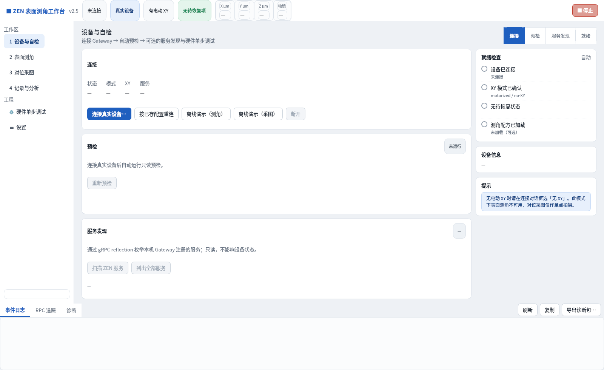

### 02 · 四点测角完成：采集与拟合通过，状态展示未完整同步

四条记录完整，Rx/Ry 单位为 µrad；配方标签和流程步骤仍不正确，右侧部分控件文字挤压。

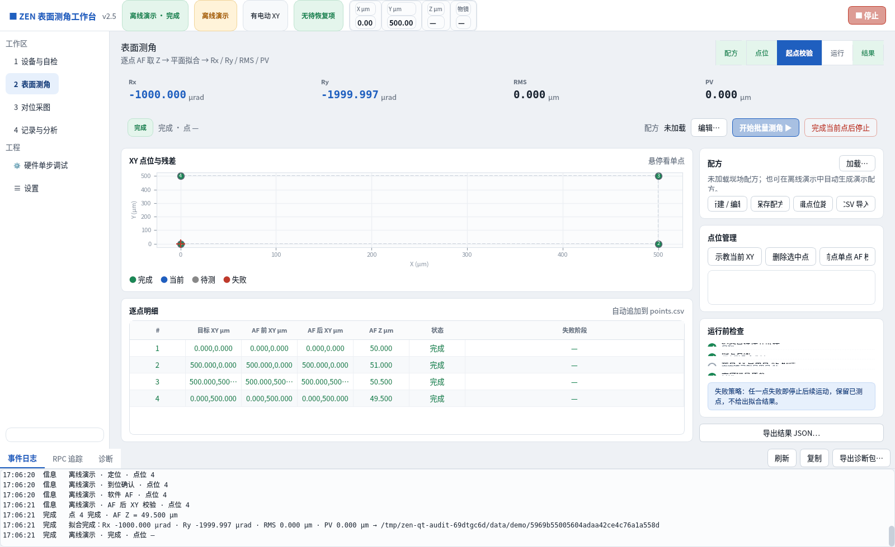

### 03 · 路径编辑：正常增删改序及应用通过

表格单位清楚，有取消与应用入口。本次只验证正常数值编辑，没有完整覆盖全部非法输入、键盘和屏幕阅读器流程。

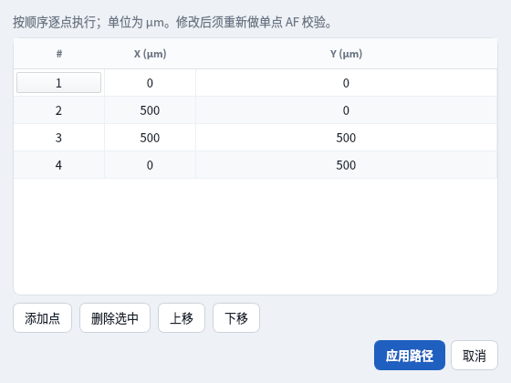

### 04 · mark 初始参数：能显示示教范围，需要滚动才能完整看到执行区

截图中的 100/200 µm 是演示数据，不能作为现场目标。

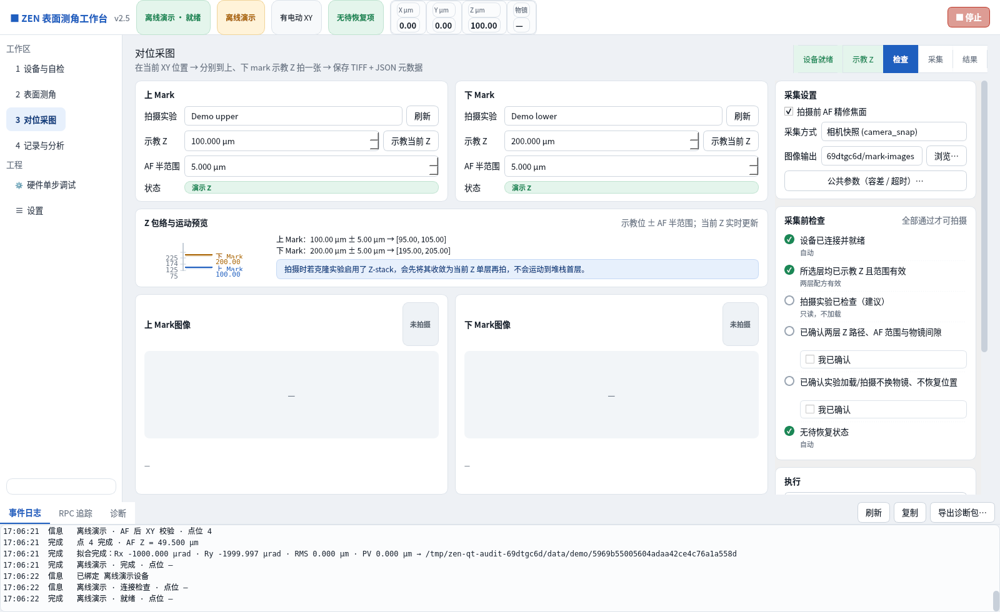

### 05 · 模拟上下图采集完成：文件与图片对状态通过

两张文件和配套 JSON 已核对。图框显示“预览不可用”是本次 Linux Qt 运行环境没有 TIFF reader；不能直接推断 Windows 发布版也失败，详见第 5 节。

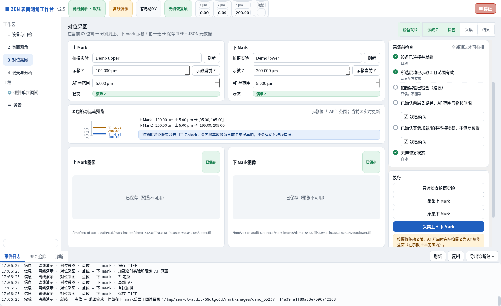

### 06 · 运行记录列表：基本归档通过，业务字段读取需修正

能列出测角与采图任务；图片数、采图有效性等问题见 R08。

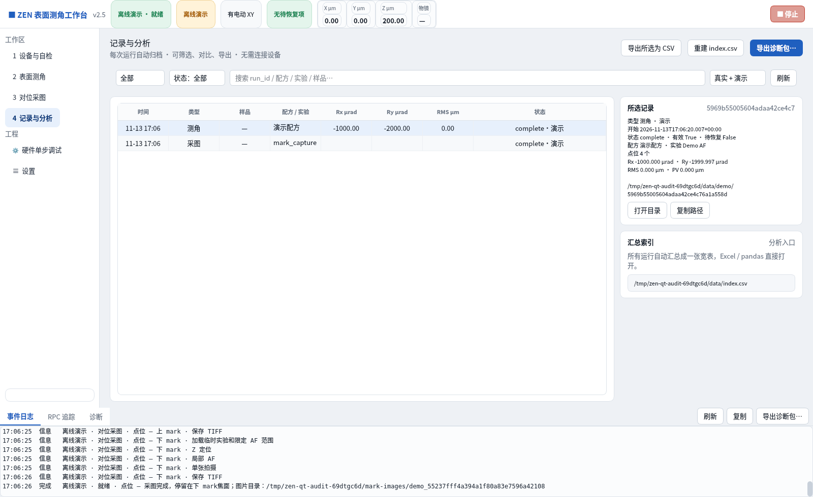

### 07 · 单步 Load：调用与日志通过

模拟 Load 返回 `demo-loaded`，并生成恢复锁。顶部红条能明确区分“请求成功”与“仍待确认”。

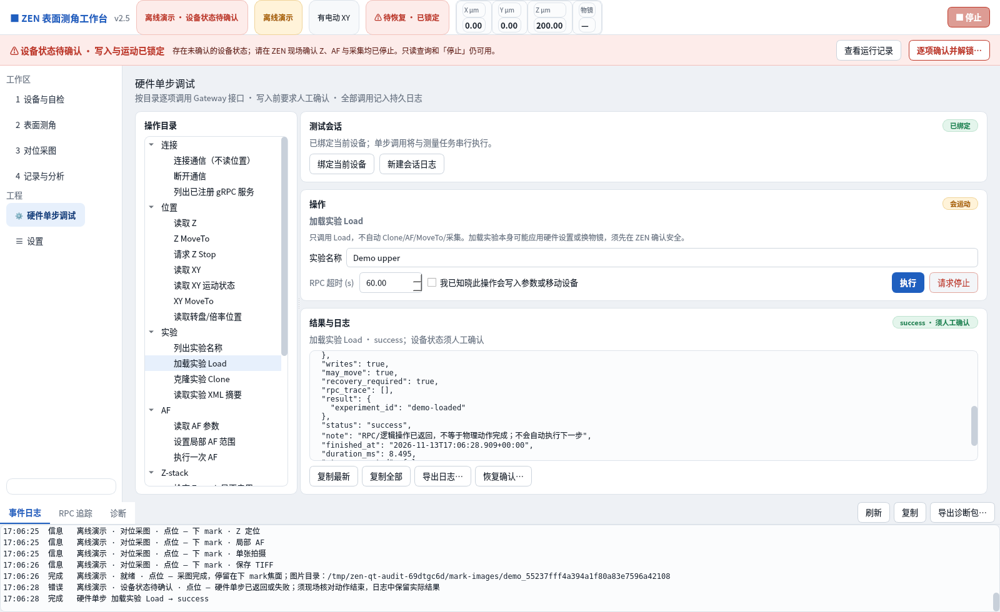

### 08 · 切换 Export：实验 ID 丢失

日志里保留刚返回的 ID，但上方新操作的 ID 框为空，见 R07。

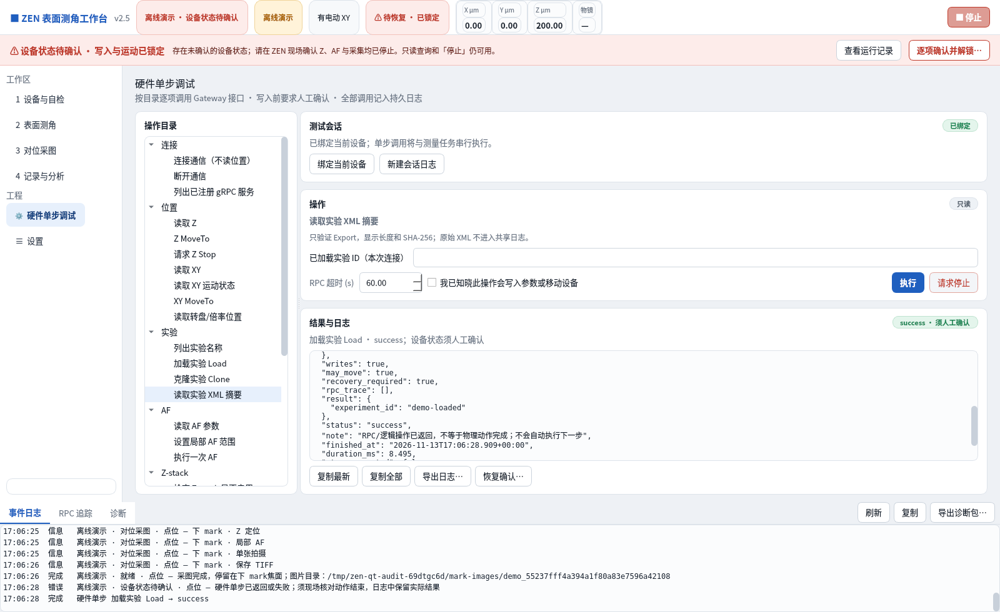

### 09 · 修改 mark 参数：旧确认仍保留

实验名与 Z 已改变，两项确认仍勾选。当前截图另有恢复锁，动作按钮因此禁用；确认未失效是独立的问题。

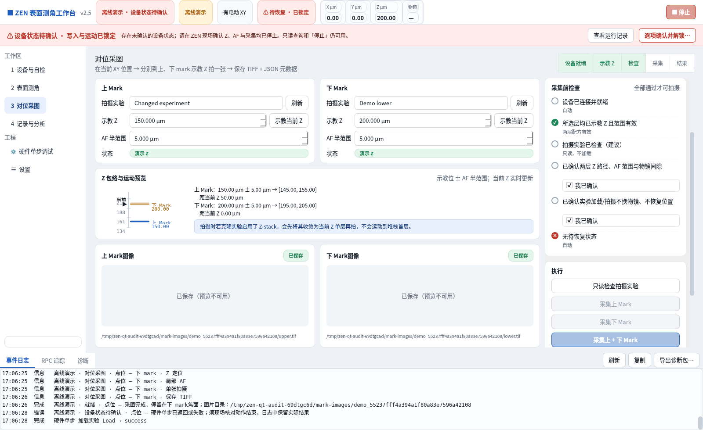

### 10 · 恢复锁：红条与禁用状态基本正确

能识别待确认记录，提示只读仍可用。但随后无法通过 Qt 恢复弹窗操作，见下一步。

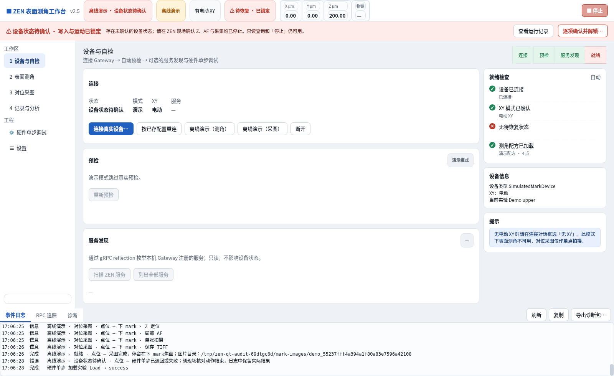

### 11 · 恢复对话框：阻塞，无法取得正常窗口截图

创建时即触发 `QCheckBox.setWordWrap` 异常。见 [recovery-error.txt](evidence/recovery-error.txt)。没有将不完整或空白对话框作为有效截图。

### 12 · 设置页：可打开，跨重启持久化尚有缺陷

路径和兼容选项可以查看；并不表示全部偏好已正常保存。

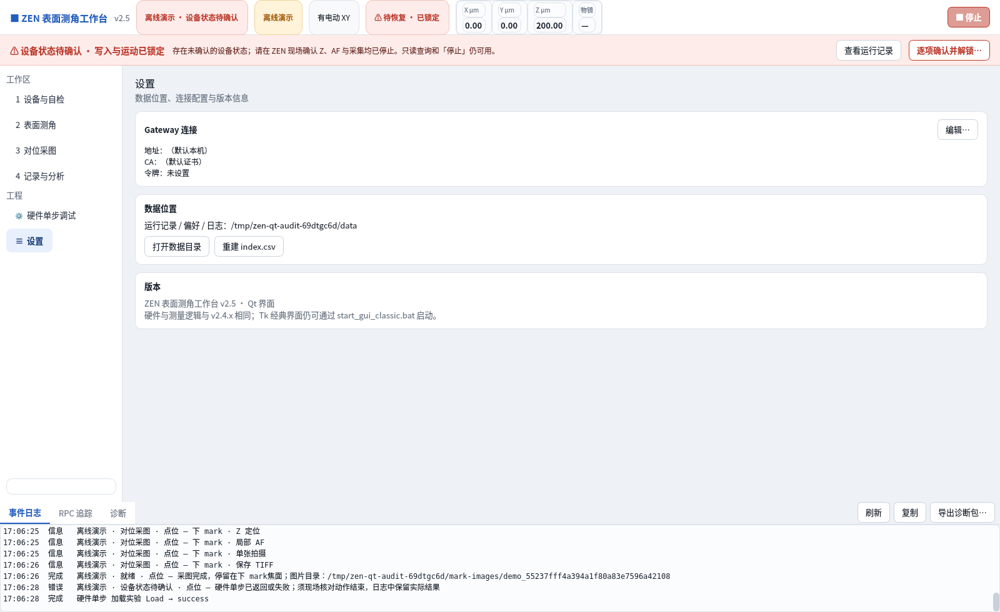

### 13 · 1366×768 请求：实际 1366×780，布局异常

不是裁剪后的大图，截图就是程序在该尺寸请求下渲染出的窗口。输入框、标签、路径发生重叠，不宜作为小屏现场操作布局。

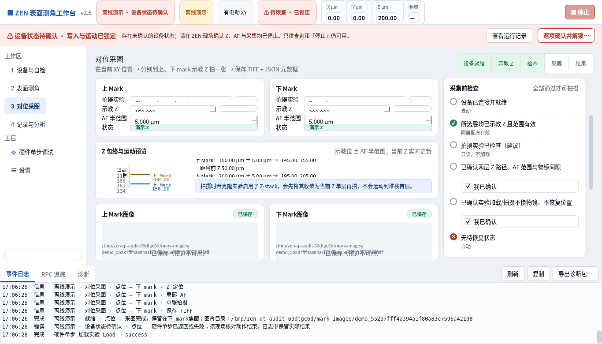

### 14 · 连接对话框：缺少 XY 模式选择

实际仅有地址、CA、令牌与三项兼容开关，没有模式选择。此处令牌为空，未上传认证信息。

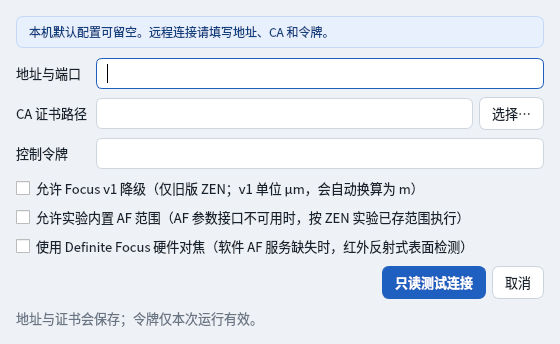

### 15 · 预置无 XY、关闭 AF：成对模拟采图通过

通过偏好预设 no_xy，拍摄前 AF 关闭，两张 TIFF 与图片对元数据通过。这个测试验证底层链路保留，不弥补新版入口缺失。

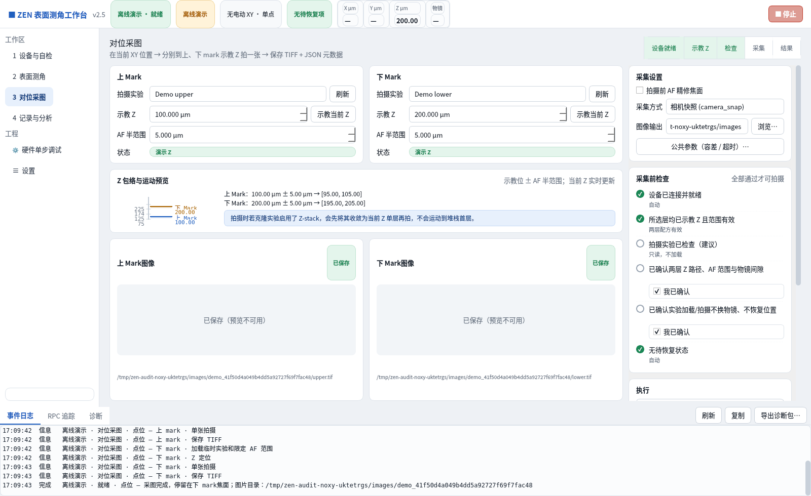

### 16 · 采图记录详情：文件完成与“有效 False”含义不清

实际有两张图，但详情没有正确显示图片数，并沿用测角有效性字段，容易让用户以为采集失败。

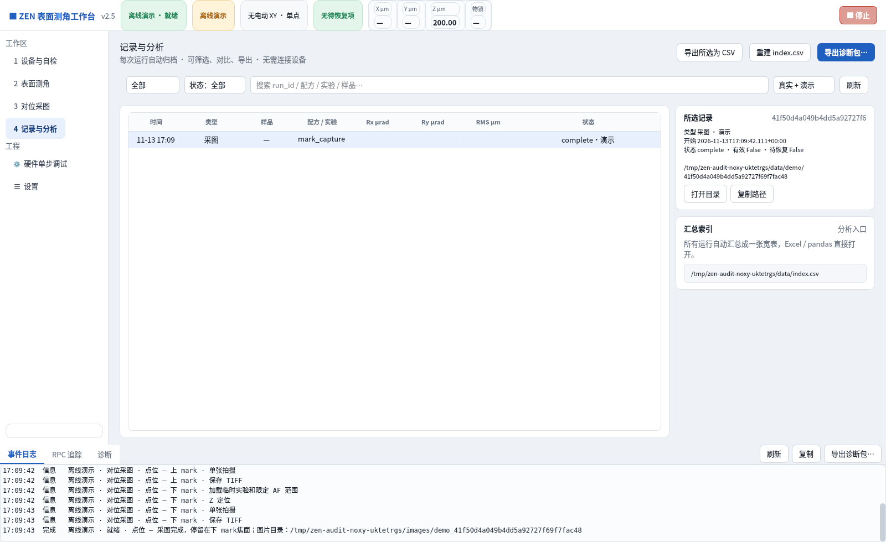

### 17 · 第三点 AF 超时：保留部分点与恢复锁通过，模式提示残留

前两点保留、第三点标为失败，角度指标为空，不继续输出有效角度；红色锁生效。页面仍显示过期的无 XY 提示，与顶部电动 XY 冲突。

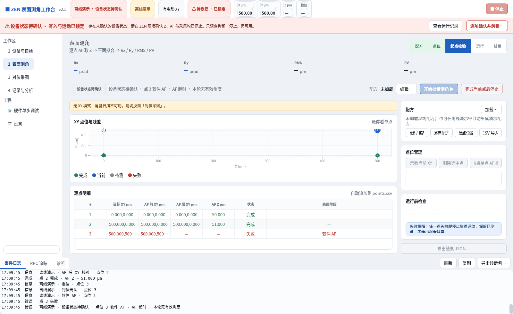

## 5. 预览、可读性与验证限制

### TIFF 预览不能跨平台直接下结论

Linux 本轮 `QImageReader.supportedImageFormats()` 中无 tif/tiff，因此图像保存成功但 QImage 预览失败。随后检查了实际 V2.5.0 Windows 便携 ZIP，包含 `PySide6/plugins/imageformats/qtiff.dll`。

因此：**本轮已确认 Linux 截图预览不可用；Windows 包存在插件，是否能在目标电脑解码 8/16 位 TIFF，需要再实际打开确认。** 没有将 Linux 插件差异写成“Windows 安装包必然缺 TIFF 支持”。详见 [发布包插件清单](evidence/shipped-runtime-check.json)。

可考虑使用现有 tifffile/NumPy 为预览提供受控转换，显示缩略图时不得改写分析用原始 TIFF。

### 可读性与可访问性观察

- 优点：真实/演示标记、恢复红条、风险说明和固定日志区增强了状态可见性；多数表单有文字标签，连接对话框有可见焦点边框。
- 风险：小屏文字重叠、按钮文字裁切及较小的次要文字会影响辨认；绿色“success”与仍待确认状态并列时，需要继续使用明确文字说明。
- 本轮没有完整测试屏幕阅读器、全键盘路径、Windows 高 DPI、系统高对比度或对比度数值，不宣称符合完整无障碍标准。
- 本轮没有实机验证运动、AF 搜索范围、共聚焦成像、SOMA 导入或物镜安全。模拟截图不能作为实机能力证明。

## 6. 修复与验收建议

1. **先修 R01/R02/R03**：实际恢复弹窗、无 XY 选择、旧配置迁移，让现场用户能启动、选对模式并正常处理锁定。
2. **再修 R04/R05**：确认失效与 AF 范围验证，避免 UI 重构或兼容分支弱化动作边界。
3. **补齐 R06/R07/R08**：参数往返保存、实验 ID 生命周期、最终采图记录读取，满足连续使用与追溯。
4. **修 R09/R10/R11**：小屏布局、实验名列表和会话卡/流程提示，再补 Windows 实际渲染检查。
5. 在 CI 增加旧偏好启动、参数保存重开、演示切现场、Load→Export、点击真实恢复弹窗、采图记录图片数和小屏布局检查；不能只增加演示次数。
6. 完成软件回归后，再在已知安全的现场实验上逐项验收旧版 AF 与正式 mark，保留每步实际接口路径及单位，不对超时动作自动重试。

## 7. 本轮机器可读证据

- [主要流程与截图尺寸](evidence/runtime-results.json)
- [边界复现检查](evidence/extra-results.json)
- [无 XY 与故障流程](evidence/noxy-fault-results.json)
- [实验名刷新与会话字段](evidence/remaining-results.json)
- [Windows 便携包插件检查](evidence/shipped-runtime-check.json)
- [核心测试日志](evidence/core-tests.log)
- [Qt 冒烟测试日志](evidence/qt-smoke-tests.log)
- [恢复弹窗错误栈](evidence/recovery-error.txt)

证据只含本轮模拟/本机检查和临时路径，不含用户令牌、私钥、实验 XML 或真实样品图像。
