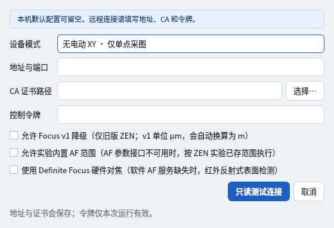
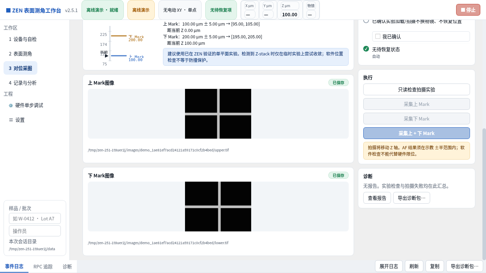
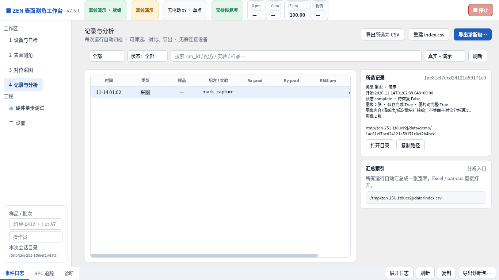
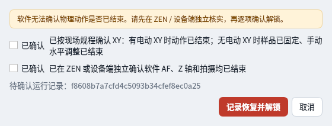

# V2.5.1 Qt 重构问题修复与验证

本版修复 [V2.5.0 审查](../v2.5.0/README.md) 发现的问题，保留历史审查证据。

## 修复范围

- 恢复确认窗口能正常打开，必须分别确认设备动作与采集结束后才能记录解锁；归档识别独立的恢复确认文件。
- 设备页与连接窗口均可选择无电动 XY 模式；忙碌时禁止切换。
- 兼容旧版输入偏好。旧界面 `_m` 偏好键实际保存的是微米输入字符串，本版明确记录 `entry_unit: um`，不按字段名误转单位；真正配方与 API 仍使用米。无效草稿保留，执行前必须修正。
- 修改实验、Z、范围、采图方式等参数会清除旧确认；演示坐标不会带入现场连接，现场配置不会被演示覆盖。
- AF 参数不能读回时默认阻止未验证范围的写入，必须使用明确的兼容选项。不会因 Get 不支持而默许 Set。
- 硬件库 Load 返回的实验 ID 可传递到 Export、AF 等测试；断开或切换设备清除 ID。超时按用户输入执行，不再暗中延长。
- 位置轮询、只读实验检查和开机检查共享工作流互斥门，避免与动作并发。修正开机检查适配器参数及服务发现通道引用。
- 最终采图记录读取 capture.json，显示图片数、单层完成和双层完成；不把单层采图错误解释成角度结果无效。
- 修复会话字段、实验列表刷新、演示配方标识和步骤状态。1366×768 界面可滚动，日志可折叠。
- 支持 TIFF 预览的 NumPy 回退，包括 16 位灰度图；显示转换不改写原始 TIFF。TIFF 仍来自 API 图像数据，不经 CZI 转换。

## 验证方式与边界

新增 15 项 Qt 回归测试，覆盖参数持久化与单位、旧确认失效、设备切换、实验 ID、归档、TIFF 原文件字节不变、小屏滚动和互斥门。核心及 wire 测试 58 项、Qt 测试 18 项；Windows 构建另运行传统 Tk 回归 15 项，并安装验证生成的安装包。

以下为 Linux Qt offscreen 实际运行截图，使用无 XY 模拟设备；不是实机采图，也不是 Windows 桌面截图。软件读回与人工确认不能代替设备硬件限位；ZEN 3.12 的 AF、实验加载与镜头设置仍需现场复验。不得把接口返回成功视为所有物理动作完成。

### 连接与模式选择

### 上下 Mark TIFF 预览

### 最终记录归档

### 恢复确认

