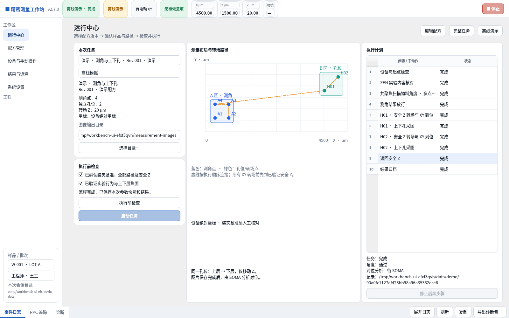
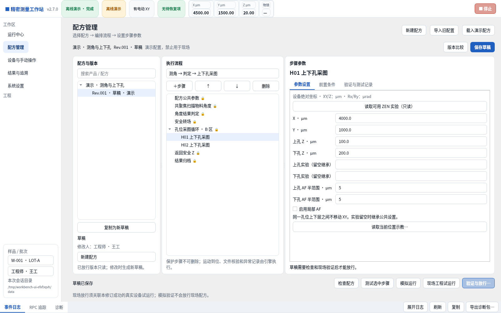
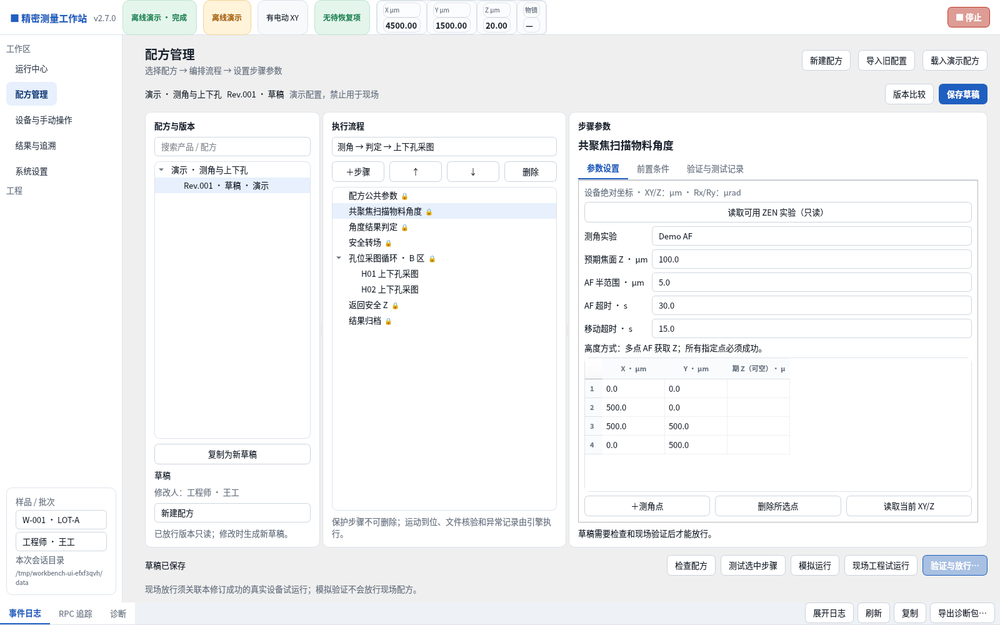
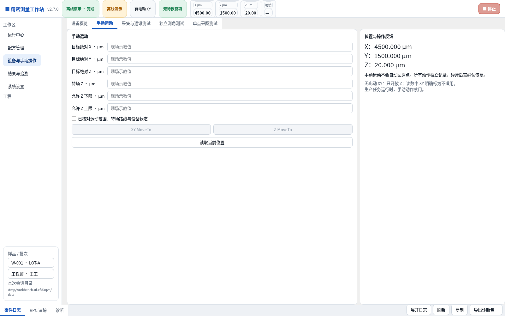
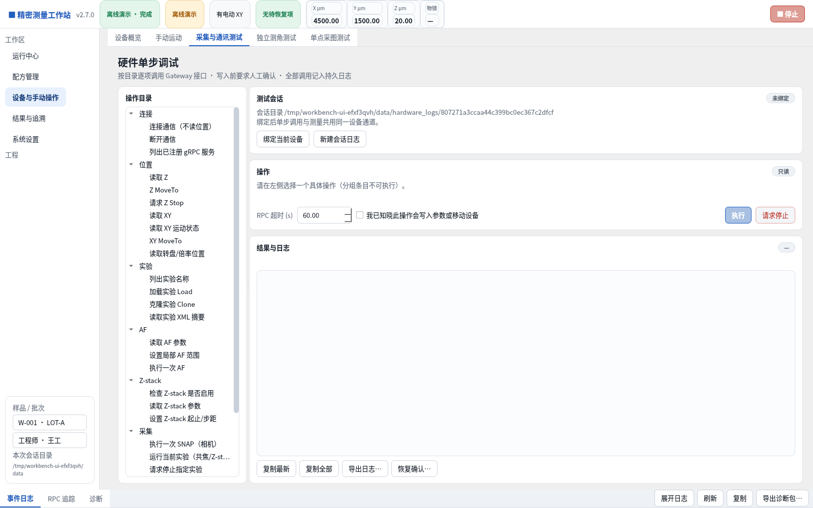
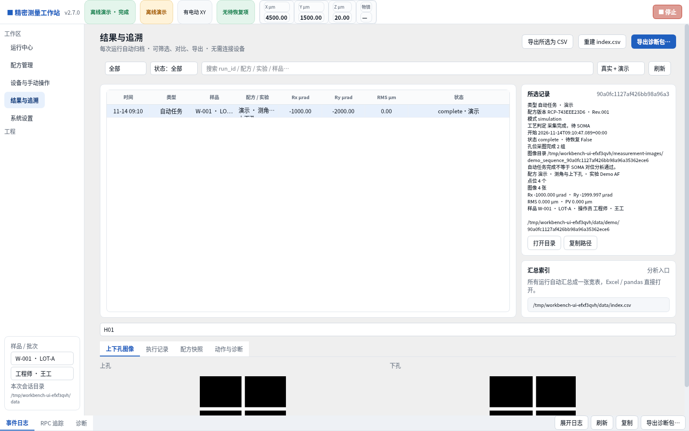
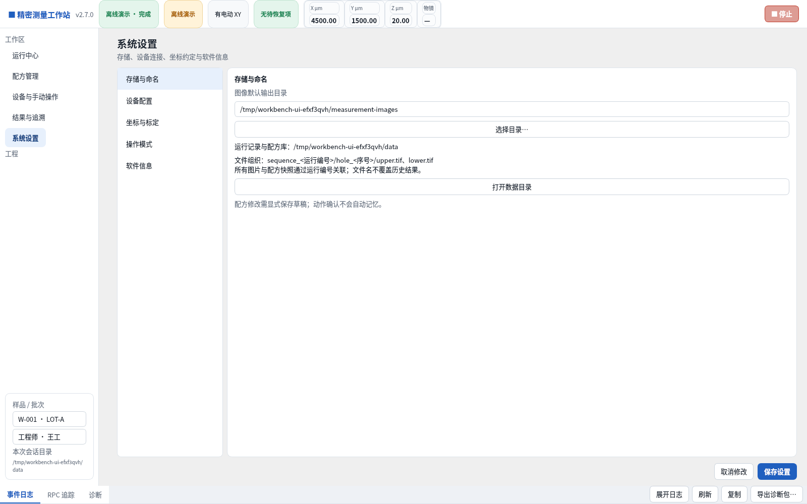
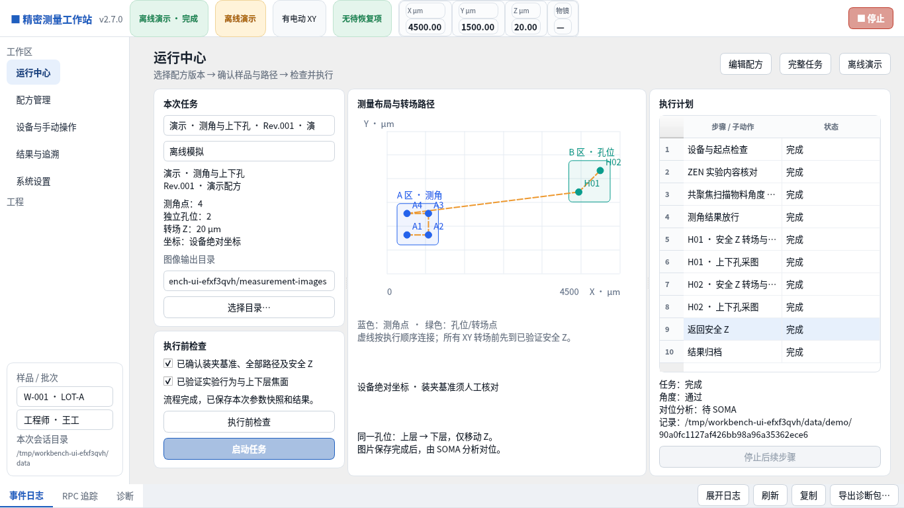

# V2.7 配方驱动工作站：实现与验收

基于 Workbuddy 分支 `46522d0` 重构，目标是让“配方编辑 → 检查 → 工程试运行 → 放行 → 正式运行 → 结果追溯”使用同一份工艺数据。模拟通过不代表显微镜实机验收通过。

## 五模块

1. **运行中心**：选择配方修订及执行模式，读取独立参数快照；显示 A 区测角点、B 区孔位、实际顺序路径、完整步骤和结果状态。启动前必须填写样品、操作员，完成检查并确认装夹、路径和实验行为。禁用按钮有条件说明。
2. **配方管理**：配方/修订、流程树、步骤参数三栏。参数随步骤类型变化，包含测角点表（可逐点设置预期 Z）、实验选择、AF 范围、Rx/Ry/RMS 判定、公共运动参数、独立孔位和转场点。支持示教、版本差异、显式保存、复制和旧 Sequence 配置导入。
3. **设备与手动操作**：设备概览、手动运动、采集通讯测试、独立测角测试、无 XY 单点采图测试。工程页分别滚动；动作使用共享任务互斥门，生产期间禁止冲突命令。旧独立测角页的批量入口转向配方管理，避免绕过新执行链。
4. **结果与追溯**：角度、图像、运行步骤、参数快照、动作诊断；逐孔图像选择与 TIFF 预览。预览仅拉伸显示，不改变原始文件。任务完成、角度不合格、设备故障和待 SOMA 分开记录。
5. **系统设置**：图像存储、设备连接、坐标约定、操作模式、版本与诊断。记录目录按应用启动配置确定；本版不提供身份认证、自动样品对准或虚构标定证书。

## 配方与执行规则

- 正式运行只使用已放行修订；允许经过参数检查及明确人工确认的草稿进入现场工程试运行。
- 演示配方只能用于模拟设备，不生成现场放行证据。旧预览中自动生成的“示例数据”配方被隔离为演示草稿。
- 当前坐标为**设备绝对坐标**，装夹基准由现场核对。不得把界面标注理解为已经实现样品坐标变换。
- 公开编译入口为 `compile_body()` / `compile_revision()`，输出以 SI 为单位的不可变 `SequencePlan`。界面使用 µm、µrad、s；步骤和孔位使用稳定编号。
- 工艺模板为“测角 → 判定 → 上下孔采图”和“仅上下孔采图”。可配置孔位、转场点及顺序；保护步骤和到位检查不能删除。单步测试带独立作用范围，不能用于正式完整任务或放行完整配方。
- “共聚焦扫描物料角度”的高度来源是**多点 AF 获取 Z**，并非 Z-stack 图像分析。逐点先到转场 Z、XY 到位、预期焦面、准备临时实验与限定 AF 范围、确认范围读回，再执行 AF。无法验证范围时停止。
- 各孔位独立示教上下层 Z，不从测角平面外推。上下层之间不移动 XY。所有 XY 转场前执行安全 Z 并确认到位。
- 运行冻结配方 ID、修订、内容哈希、参数、样品和操作员。编辑草稿不能修改当前运行；结果事件不会覆盖冻结的会话信息。
- 正常任务结束返回转场 Z；角度不合格时不进入孔位区。异常或停止不自动重试、跳点、回原点或续跑；已有图片保留，未知动作状态保持恢复锁。

## 验证与放行

1. 编辑并保存草稿；检查有限数字、单位、运动范围、AF 范围、点位几何、步骤顺序和依赖。
2. 在模拟模式检查程序流程；模拟任务不能作为现场验证证据。
3. 连接真实设备，选择工程试运行，核对装夹、各点焦面、路径、转场 Z 和实验行为后明确启动。
4. 完整真实任务成功且哈希与当前修订一致时，关联现场试运行记录。单步、失败、模拟或旧哈希记录不能关联为完整验证。
5. 工程师填写姓名，核对证据后放行。过程内容变化使检查与验证失效；单纯重复保存相同内容不丢失证据。
6. 实验通过 Load 和 Export 获取内容指纹；Load 可能影响设备，需经过位置与光学读回检查。正式运行重新核对所有使用的实验，变化或读取失败时阻止后续测量。

软件 Z 范围不是硬件限位，不能阻止 ZEN 内部动作先越界；光学读回缺失不代表物镜被锁定。现场试运行仍需要设备人员观察与验收。

## 旧数据迁移

保留历史记录与原配置文件。“导入上次配置”可直接读取旧自动记忆的偏好，不要求以前导出过 JSON。旧 `sequence_ui` 配置或偏好中的 `sequence` 导入新草稿，明确转换 m/µm、点位、焦面、阈值、超时、实验和 AF 选项。旧版本没有定义测角 AF 半范围，须重新示教确认。未知扩展不执行，导入提示要求对照原文件。Workbuddy 旧草稿缺少测角/运动字段时保留为待补齐内容，不自动赋予现场可执行默认位置。

## 自动与视觉检查

- 核心/协议/执行：94 项，包含实验变更拦截、未验证 AF 范围、逐点焦面、独立区域、异常保图、停止与互斥。
- Qt 交互：36 项，包含保存后重开、切换步骤、非法输入、模式限制、运行快照隔离、进度保留、手动安全转场及设置保存。
- Windows CI 另运行传统 Tk 15 项，共 145 项；同时执行便携运行时检查、安装包构建、静默安装及安装后检查。结果以实际 CI 为准。
- 本目录截图来自实际 Linux Qt 离屏运行和模拟设备，不是设计效果图或显微镜实测。演示包含 4 个测角点、2 组独立孔位、4 张 TIFF。
- 检查尺寸 1600×1000、1366×768，并以 Qt 125%/150% 缩放重复捕获。字体/DPI 的 Windows 原生外观仍须安装后确认。
- UI 检查按已确认设计的模块、三栏层级、参数关联、流程可见性、控件状态、单位、错误原因、图像追溯和小屏布局逐项核对。截图用于直接对照；不把“95%”宣称为客观像素相似度或用户验收结论。

## 实际截图

复现：在已安装官方存根的 Python 环境，从仓库根目录执行 `PYTHONPATH=.:<存根目录> python docs/workbench-v2.7/capture.py`。脚本仅连接模拟设备。`simulation.json` 是捕获时的模拟结果。
