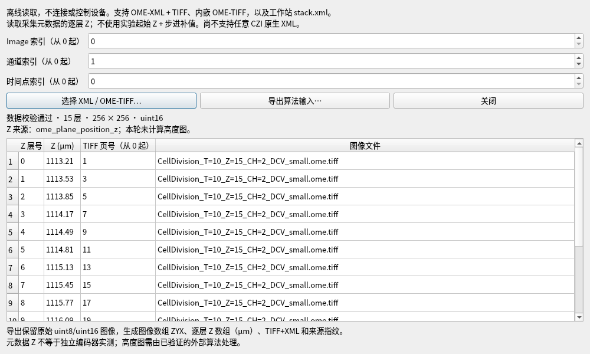
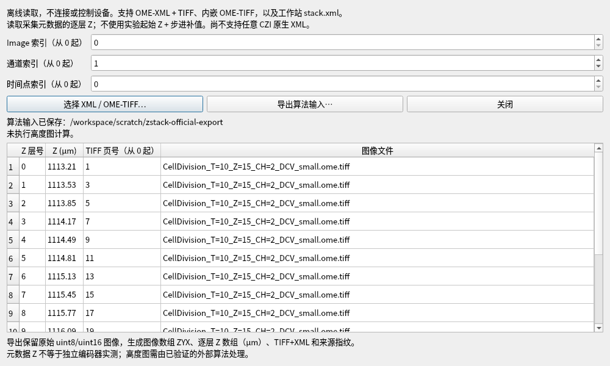
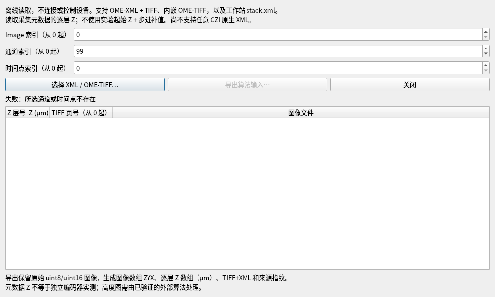

# Z-stack 图像与逐层 Z 数据接入

本轮实现采集结果到现有高度图算法的输入交接。没有替换或重写外部高度图算法，不计算高度图、物料角度或胶厚。无新增设备 RPC，离线入口完全不访问设备。

## 使用

在“硬件单步调试”点击“Z-stack 数据…”。选择 Image、通道、时间点索引（从0开始），再选择 XML 或 OME-TIFF。数据检查通过后显示层号、Z（µm）、TIFF页号与文件；“导出算法输入”选择父目录，程序创建唯一子目录。

支持三种明确格式：

- **OME-XML + TIFF**：`Pixels/Plane` 的 `TheZ/TheC/TheT/PositionZ/PositionZUnit` 提供逐层Z；`TiffData/UUID@FileName`、IFD及DimensionOrder确定图像页。不按文件名排序、不使用最大强度投影代替原始堆栈。
- **内嵌 OME-TIFF**：从文件内直接读取同样的OME元数据，不要求额外导出XML。
- **工作站 stack.xml**：本软件定义的 `ZenSurfaceStack version="1"`，不是蔡司官方通用XML格式。现有配方中的Z-stack步骤在采集、读回及图像验证通过后，额外写出该文件。使用逐帧 `frame_stage_position.z`，API单位m转换成µm；模拟明确写作`simulation`。原有TIFF/JSON保留。`stack.json`完成清单最后写入。

原生 CZI 元数据 XML、实验配置 XML、任意同事自定义 XML 尚不接受。遇到这些文件会明确报不支持，不猜字段、不把实验参数当采集结果。取得现场实际文件后可增加针对性适配。

## 校验与限制

- 必须有完整逐层 Z，支持非等距及递减扫描；要求严格单调、无重复。缺少PositionZ时拒绝使用起始Z、PhysicalSizeZ或步进推算补值。
- Z元数据表示文件或API报告的采集位置，并不等于独立编码器测量或已证明的几何高度精度。
- 显式选择一个Image、一个通道、一个时间点；拒绝RGB、颜色交错采样、缺页、重复图像页、尺寸或位深不一致。保留原始uint8/uint16灰度数据，不做归一化。
- OME长度单位按标准默认µm，显式单位支持m/mm/µm/μm/um/nm；工作站XML明确指定µm。缺失像素标定或未知单位报错。
- XML≤16MiB，禁止DTD/实体；TIFF必须位于XML所在目录及子目录，不接受父目录、绝对路径或网络URL引用。
- 图像数组及拼接工作内存限制512MiB（不含解析器/解码器开销），层数2–4096。文件来源计算SHA256。
- 加载失败或修改索引立即清空旧数据、禁止导出旧结果。后台任务执行时阻止重复启动与关闭；它是本地有限任务，不下发停止或其他硬件指令。
- 输出先写临时目录，全部成功才公开结果目录。保存失败清理临时目录，已有结果不覆盖。

## 算法交接

输出目录包含：

| 文件 | 内容 |
|---|---|
| `images_zyx.npy` | 原始灰度像素，形状`(Z,Y,X)`，保留uint8/uint16 |
| `z_um.npy` | 与第一维严格对应的float64逐层Z，单位µm |
| `z_0000.tif`等 | 拆分后的原始平面 |
| `stack.xml` | 可再次导入的工作站XML清单 |
| `source.json` | 源路径、选择索引、源图像页、XML及图像SHA256、Z来源；明确`height_map_computed=false` |

Python直接调用：

```python
from zen_stack_data import load_stack, export_stack
stack = load_stack('sample.xml', channel=0, timepoint=0, image_index=0)
images_zyx, z_um = stack.algorithm_input()
# 将这两个数组交给现有、已验证的高度图算法。
export_stack(stack, 'new_output_directory')
```

## 实际运行证据

使用蔡司OAD固定提交 `781ce14954946366524b96347e7767cefb11a2c8` 中的[真实样例目录](https://github.com/zeiss-microscopy/OAD/tree/781ce14954946366524b96347e7767cefb11a2c8/jupyter_notebooks/Read_CZI_and_OMETIFF_and_Napari/testdata)。

`CellDivision_T=10_Z=15_CH=2_DCV_small_OMETIFF_MetaData.xml`及对应OME-TIFF均成功读取：选通道1、时间0，15层、256×256、uint16；前3层Z为1113.21、1113.53、1113.85µm，末层1117.69µm，XY像素尺寸0.09057667415221031µm。外置与内嵌元数据结果一致；这份样例是图像格式验证，不是共聚焦测高精度证据。

实际Qt离线运行完成读取、导出及错误输入后旧数据清空；以下截图不是设计渲染：





新增自动回归覆盖非等距/递减Z、单位、通道页映射、内嵌元数据、完整性、非法XML、文件引用、内存限制、原始位深、保存失败、导出回读、重复点击和界面状态。现有在线模拟Z-stack流程增加XML回读断言。

本轮未连接真实设备，未调用现场实验。现场XML具体格式、在线逐帧Z、实际实验/导出行为及高度图算法的最终接入仍需对应样例或代码验证。
