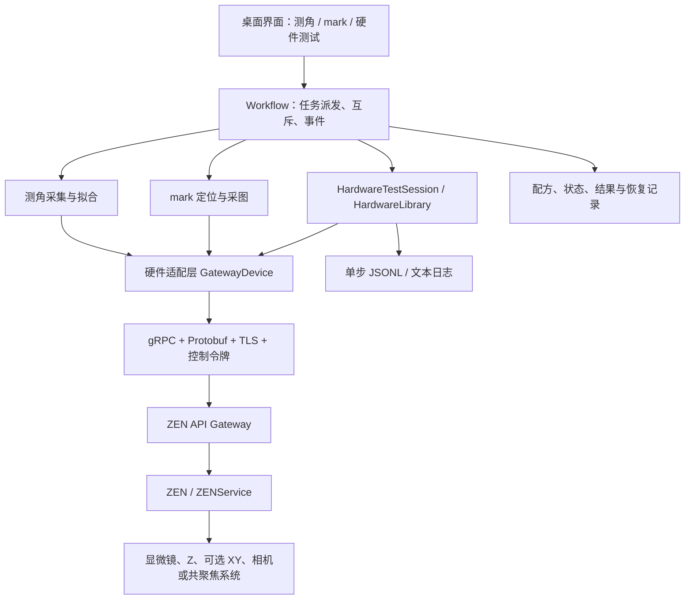

# ZEN 显微镜控制工具：设计目的、设计思路与资源索引

> 文档日期：2026-11-12。描述基线：V2.4.0 联调预览版，代码提交 `36cd014abd3741c064b56d20f5b39189d35eb023`。  
> 本文面向现场使用人员、后续开发者和设备接口支持人员。它说明当前实现及依据，不代替蔡司设备操作规程或实机验收。

## 目录

1. [设计背景与目标](#1-设计背景与目标)
2. [功能范围与使用场景](#2-功能范围与使用场景)
3. [整体架构与解耦方式](#3-整体架构与解耦方式)
4. [物料角度扫描的设计](#4-物料角度扫描的设计)
5. [上下 mark 采图的设计](#5-上下-mark-采图的设计)
6. [硬件库通信与单步测试的设计](#6-硬件库通信与单步测试的设计)
7. [安全、状态与异常恢复](#7-安全状态与异常恢复)
8. [连接、单位与配置管理](#8-连接单位与配置管理)
9. [记录、日志与排查方法](#9-记录日志与排查方法)
10. [测试、构建与交付](#10-测试构建与交付)
11. [资源总索引](#11-资源总索引)
12. [兼容性边界与后续扩展](#12-兼容性边界与后续扩展)

## 1. 设计背景与目标

本工具起初用于物料表面的角度扫描：控制显微镜依次到达若干 XY 点位，通过软件自动对焦获得 Z，再拟合表面倾斜，显示 Rx、Ry 及平面残差指标。随后增加了当前点位上下两个 mark 焦面的图像保存，以及适用于没有电动 XY 的单点采图模式。

现场已有另一套平台采用“上位机业务流程 + 硬件库 + 单功能测试”的形式，但其源码无法取得。本项目借鉴的是这种职责分工和联调方式，并未取得或复用那套平台的实现代码。

设计要解决五个具体问题：

- **减少重复人工操作**：在界面编辑点位、保存配方、执行可追溯的测量，不必先在 Excel 中整理点位再导入。
- **将接口问题与业务问题分开**：先证明连接、位置读取、加载实验、AF、采集等单项能力可用，再组合成测角和 mark 流程。
- **保留成像实验的现场控制权**：共聚焦扫描、照明、通道等复杂参数仍主要在 ZEN 中配置和验证，本工具通过实验名称/ID 使用这些配置。
- **使失败可以远程排查**：失败时保留调用阶段、参数、接口名、状态码和部分结果，方便现场人员复制给开发者。
- **避免把通信成功误当成设备安全**：连接就绪、接口返回、位置回读、动作结束和业务结果有效，必须分别判断。

## 2. 功能范围与使用场景

| 场景 | 当前工具负责 | 依赖条件与边界 |
| --- | --- | --- |
| 物料表面测角 | XY 路径编辑、逐点定位、AF、Z 记录、平面拟合、Rx/Ry 与残差显示 | 需要电动 XY、可用的 AF 与位置接口；至少三个非共线点 |
| 当前点上下 mark 采图 | 示教两层 Z、局部 AF（可选）、分别采图、保存 TIFF 和元数据 | 不做 mark 识别或对位偏差计算；分析交给现场 SOMA |
| 无电动 XY 的单点采图 | 只控制/读取电动 Z，在固定样品位置拍摄单层或上下两层 | 不调用 XY；无法自动识别手动水平移动 |
| 硬件单步联调 | 对连接、位置、实验、AF、Z-stack、相机与采集逐项测试并记录日志 | 按已填写参数执行当前选中操作，不自动串成完整业务流程 |
| 无设备演示 | 模拟正常流程、故障、恢复、图像和单步命令 | 明确标记模拟，不能作为真实设备验收结果 |

当前不包含：物镜转盘运动按钮、SOMA 自动调用、图像对位算法、自动碰撞检测、硬件级防转锁、生产计量溯源或设备安全认证。上、下 mark 代表两个示教焦面，不是软件根据图像自动识别出来的层。

## 3. 整体架构与解耦方式

### 3.1 系统关系



这里的箭头表示主要职责关系，省略了底层设备 Protocol、模拟器和回传事件。生产代码通过生成的 gRPC 存根访问 ZEN API，不通过鼠标点击 ZEN 界面实现控制，也不依赖 ZEN 内部 IronPython 脚本。

### 3.2 各层负责什么

| 层 | 主要实现 | 设计职责 |
| --- | --- | --- |
| 用户界面 | `zen_gui.py`、`zen_mark_gui.py`、`zen_hardware_gui.py`、`zen_path_editor.py` | 收集输入、显示状态、显示结果、人工确认、日志复制与导出 |
| 任务协调 | `zen_workflow.py` | 共用任务互斥锁、停止标志、后台线程与界面事件；避免业务流程和单步测试同时访问设备 |
| 业务流程 | `zen_acquisition.py`、`zen_marks.py` | 明确操作顺序、检查点、容差、阶段失败和部分数据保留 |
| 数学与图像数据 | `zen_fit.py`、`zen_images.py` | 平面拟合、单位明确的结果、原始帧检查及 TIFF 保存 |
| 硬件测试库 | `zen_hardware/library.py` | 操作目录、参数校验、单步执行、日志、动作恢复记录；不依赖 Tk |
| 真实硬件适配 | `zen_hardware/gateway.py`、`mark_gateway.py`、`controls.py` | gRPC 请求、实验与位置访问、图像流、明确的单位换算 |
| 辅助能力 | `positioning.py`、`rpc_diagnostics.py`、`preflight.py`、`local_config.py` | 到位检查、接口级错误、开机检查、连接参数解析 |
| 模拟设备 | `simulator.py`、`mark_simulator.py` | 无设备验证流程、故障分支和交互 |
| 数据与偏好 | `zen_records.py`、`zen_preferences.py`、`zen_recipe.py` | 持久化记录、恢复扫描、非秘密参数记忆、配方读取 |

### 3.3 解耦的实际含义

业务层决定“为完成测角，需要先定位再 AF”；硬件层决定“定位对应哪个 RPC、请求字段和单位是什么”。硬件测试窗口复用同一设备适配层，避免维护一套专门用于测试但与正式流程不同的通信代码。

界面不在按钮回调中直接等待 gRPC；操作交给 Workflow 后台任务，结果通过事件返回主线程。这样同步调用等待期间，界面仍可刷新并提出停止后续任务的请求。

当前硬件库是 Python 模块与类的边界，没有封装成独立 DLL、独立服务或另一个进程。`HardwareLibrary` 是底层操作适配入口；需要校验、日志和恢复约束时应通过 `HardwareTestSession`，界面再通过 Workflow 执行它。原有测角和 mark 流程直接复用 `GatewayDevice` 的业务能力，并非所有业务操作都经过单步测试会话。

## 4. 物料角度扫描的设计

### 4.1 输入与路径

配方包括实验名称、绝对 XY 点位、位置容差、AF 超时、到位超时和角度符号约定。界面允许新增、修改、删除点位及上移/下移调整顺序，并预览路径方向；编辑路径本身不驱动硬件。CSV 作为可选入口保留。

点位必须为有限数值，数量不少于三个，且不能共线或近似共线。修改路径后，原先的单点验证不能直接沿用到新路径。

### 4.2 采集顺序

1. 检查当前 XY 状态，加载指定实验，并复核已确认的起点。
2. 对每一点发送 XY 移动请求。
3. 等待 XY 状态空闲，并回读坐标确认在容差内。
4. 执行软件 AF，取得有限的焦点 Z。
5. AF 后再次检查 XY，避免把漂移或错误点位的数据纳入拟合。
6. 将该点成功/失败记录写入文件，再决定是否进入下一点。
7. 仅在采集完整、数据通过检查后计算有效结果。

这套流程不会仅凭 `MoveTo` 返回就开始测量。AF 返回的 Z 是测角高度数据；其实际测量重复性仍取决于样品、光学条件、AF 算法和设备标定。

### 4.3 拟合与单位

用实际采样位置拟合平面：

```text
z = a·x + b·y + c
Rx = atan(b) × 1,000,000  µrad
Ry = -atan(a) × 1,000,000 µrad
```

实现先对 XY 居中、归一化，再求平面系数，减少大绝对坐标及小跨度带来的数值问题，并检查点位是否退化。拟合采用 Python 标准库的数值运算，不调用外部计量算法服务。

- Rx、Ry 显示为微弧度，`µrad` 与用户常写的 `urad` 表示同一单位。
- 结果字段为 `rx_urad`、`ry_urad`、`angle_unit: "urad"`。
- RMS 是拟合残差的均方根，PV 是残差最大值减最小值；内部保存 m，界面显示 µm。
- 当前正负号是明确记录的联调约定，仍需与正式设备坐标轴、样品方向和原工程约定核对，不能仅凭显示名称判断机械方向。

## 5. 上下 mark 采图的设计

### 5.1 目的与参数来源

在同一固定水平位置，分别对上 mark 和下 mark 对焦并保存图像，为后续 SOMA 分析提供输入。工具不计算两张图的偏移，不输出对位合格结论。

每层填写：已在 ZEN 准备好的实验名、示教的绝对 Z、局部 AF 半范围；公共参数包括 Z/XY 容差、稳定等待、各类超时、采集方式和是否使用 AF。实验名称用于请求 ZEN 加载对应实验，不是软件从名称推算曝光或扫描参数。只读列名检查也不能获得完整实验配置。

### 5.2 业务采图顺序

1. 记录起点和可读取的物镜/中间倍率位置。
2. 加载对应层实验，建立临时实验实例；启用 AF 时在临时实例设置并回读校验局部范围。
3. 将 Z 移到示教目标，连续回读到位并完成稳定等待。
4. 若启用 AF，执行局部 AF；检查焦点及最终 Z 在所选层范围内。
5. 使用明确选择的方式拍摄单张图，并检查完整帧、位置和几何信息。
6. 保存该层 TIFF 与元数据，再进入下一层。

开启双层 AF 时，两层搜索区间必须不重叠，避免上下 mark 之间串层。只拍一层时，输出不能视为完整图片对。结束后停留在最后拍摄层，不自动返回起始 Z。

### 5.3 为什么业务流程克隆实验

业务采图需要临时修改 AF 参数，也需要将 AF 与正式曝光产生的图像区分开。克隆用于隔离临时修改、避免保存覆盖原实验，并通过独立曝光实例降低误收 AF 旧帧的风险。这里的 Clone 是一项真实的 API 依赖，现场没有此方法时会明确失败。

克隆不是物镜安全措施，不保证加载或运行实验不会改变硬件。**硬件单步测试则不同：AF、SNAP 等按钮不隐式克隆；只有明确选择 Clone 才执行 Clone。**

### 5.4 相机与共聚焦明确分开

| 选择 | 主要调用 | 用途 |
| --- | --- | --- |
| 相机拍照 / 定位 Snap | `ExperimentService.RunSnap` | 用户明确需要相机图像 |
| 共聚焦采集 | `ExperimentService.RunExperiment` | 使用 ZEN 采集页已验证的实验 |

共聚焦接口失败时不自动改用相机，因为相机定位图不能替代共聚焦测量图。正式 mark 采图要求单通道、单 Z 层、单时间点且无场景/拼图等多维结果，并检查实验状态和完整图像；不能直接将 Z-stack 实验当成单平面 mark 实验。

### 5.5 图像完整性与标定

当前转换支持 Gray8、Gray16、BGR24、BGR48。写入 TIFF 时保留位深和原始像素，仅将 BGR 通道顺序变为 TIFF 使用的 RGB，不做缩放、增强或自动降位深。

图像必须有有效尺寸、正确字节数、有效像素标定和可核验的 Z；当前单帧检查设有 256 MiB 上限。上下图须匹配尺寸、ROI 原点、通道、像素类型及像素尺度，否则不发布完整图像对。

`capture.json` 保存实验、实际位置、焦点、像素尺寸、模式、状态和图像说明。SOMA 能否直接读取 TIFF 标定需要实测；必要时使用记录中的 `scale_x_m_per_pixel × 10⁶` 和 `scale_y_m_per_pixel × 10⁶`，以 µm/pixel 手动输入。

### 5.6 无电动 XY 模式

无 XY 模式下，不读、不写 XY，也不查询 XY 运动状态；禁用真实测角和 XY 示教，但保留 Z 与单点采图。

未知 XY 写为 `null`，`xy_verified` 为 `false`，不伪造 `(0,0)`。若原始帧缺少 Z，仅在这个模式下允许采后 Focus v2 回读，并记录 `z_source: "focus_readback_after_capture"`。固定光路设备明确不提供转盘/倍率位置方法时，可以记录未校验，由操作员独立确认光路不变；其他认证或通信错误不能一律当作“不适用”忽略。

## 6. 硬件库通信与单步测试的设计

### 6.1 操作目录与职责

`OPERATIONS` 定义操作键、名称、分组、字段、写入标记、可能运动标记、XY 要求和说明。界面据此生成参数区域，参数在调用前校验。新增操作应首先定义这些属性，再实现设备适配与测试。

| 分组 | 当前提供的操作 | 设计说明 |
| --- | --- | --- |
| 连接 | 连接通信、断开通信 | 绑定不连接；连接只建立通道，不隐式读取位置 |
| 位置 | 读 Z、Z MoveTo、Z Stop、读 XY、读 XY 状态、XY MoveTo、读物镜/倍率位置 | 无 XY 禁止 XY 请求；不提供转盘旋转按钮 |
| 实验 | 列出实验、Load、显式 Clone、Export 摘要 | 显示实验 ID；XML 只记录长度和 SHA-256，不写入共享日志正文 |
| AF | 读 AF 参数、设置局部 AF 范围、执行一次 AF | 设置范围先 Get 再 Set；AF 不附带加载、克隆、定位或拍照 |
| Z-stack | 检查维度是否启用、读参数、设置首末层与步距 | 设置不自动启用维度、不执行扫描、不保存覆盖原实验 |
| 采集 | SNAP、RunExperiment、停止指定实验、读执行状态、读图像输出目录 | 用明确的实验 ID；不使用空 ID 停止未知实验 |
| 相机 | 列出相机、读相机/曝光范围、设置曝光 | 曝光先读相机，检查范围并保留 binning 与 ROI |

“单步”表示一项明确的逻辑操作，未必严格只有一个 RPC。例如设置曝光需要先读再配置，设置 AF 范围需要先读取现有设置。界面说明会列出这些必要调用，而不会自动追加完整业务流程。

### 6.2 与业务采图的区别

硬件单步 SNAP / RunExperiment 不自动订阅像素流，不自动转换 TIFF。它用于确认 ZEN 是否接受并运行该命令，可再独立查询实验状态和 ZEN 图像保存目录；实际文件输出取决于 ZEN 实验和保存设置，须现场核对。

正式 mark 流程则需要完整图像流、位置校验、图像几何检查和本机 TIFF 保存。因此“单步采集成功”只证明对应阶段，不证明完整 mark 链路已通过。

### 6.3 参数与生命周期

目标位置不提供可直接执行的现场默认值；输入采用 µm，内部转换为 m。实验 ID 属于本次连接，不写入自动偏好，重新连接或断开时清空。加载/克隆成功后将返回 ID 填入本次测试窗口。

写入与动作需要逐次人工确认，执行后勾选重置；Stop 请求是例外，但仍需核对设备状态。可能运动的操作在发送前建立持久恢复记录，接口返回后也不自动解除。存在待确认动作时可继续只读检查或请求 Stop，不能直接开始下一次普通写入。

## 7. 安全、状态与异常恢复

### 7.1 需要分别判断的状态

```text
通道已建立
  → 某个只读 API 已通过
  → 所需实验与动作 API 已逐项验证
  → 设备端确认当前动作结束、路径安全
  → 当前业务前置条件满足
  → 本轮业务完成且结果有效
```

这是验证层次，不是系统会自动依次完成的状态机。TLS 成功不能证明令牌被业务方法接受；某个位置接口成功也不能证明全部采集接口存在。

### 7.2 防止不确定状态被忽略

- 测角、mark 和硬件测试共用 Workflow 的任务互斥锁，当前进程内不并发发送这些流程。
- 真实 gRPC 通道禁用自动重试，避免超时后重复发送运动/采集命令。
- 异常时保留已完成点位或图像，不自动重拍、不自动返回 Z。
- 未结束或状态不确定的记录保存在本地，重启/重连后重新扫描；重连本身不能解除恢复锁。
- 恢复需由操作员在 ZEN/设备端独立核对 XY（或手动固定状态）、Z、AF 与采集结束，再写入 `recovery.json`。

共享任务锁只约束当前工具进程，不能替代 ZEN/Gateway 对其他客户端、ZEN UI 或其他软件的控制管理。

### 7.3 物镜与撞机边界

本工具没有直接转动物镜转盘的测试按钮。但 **Load、运行实验等操作本身可能应用物镜或位置设置**。回读位置只能帮助发现变化，不能在变化前建立硬件防撞屏障；读到 Z 也不意味着已锁定转盘。

因此必须在 ZEN 中核对所用实验不会造成危险的换物镜、位置恢复或其他动作。软件无法替代机械限位、硬件互锁、设备规程及现场间隙检查。

### 7.4 停止与超时

“请求停止后续任务”是软件停止标志，不保证取消已经发送的同步 RPC。Z Stop、Experiment Stop 也只表示请求某个服务停止，不证明全部相关轴或 AF 已结束。RPC 超时、连接断开和进程退出，都不能作为“物理动作停止”的证明。

## 8. 连接、单位与配置管理

### 8.1 Gateway 是统一入口

现场曾报告 Gateway `3.6.25020.7`、ZEN `3.12`，托盘显示：

```text
Gateway: https://localhost:5002/
  forwarding to ZENService: https://localhost:5024/
  forwarding to ZEN:        https://localhost:5025/
```

工具地址填写 **`localhost:5002`**，不带 `https://` 或末尾斜杠；5024/5025 是该现场的内部服务转发目标，不应据此改填。软件历史兜底地址仍为 `127.0.0.1:5000`，不是自动发现结果，须以实际托盘地址覆盖。

### 8.2 证书与令牌

| 项目 | 当前机制 |
| --- | --- |
| TLS | 使用 Gateway CA 校验服务器，不通过关闭校验解决连接问题 |
| CA 默认路径 | `%PROGRAMDATA%\Carl Zeiss\ZEN APIGateway\Certificates\ZEN APIPersonalSigningRootCA.pem` |
| 控制令牌默认文件 | `%PROGRAMDATA%\Carl Zeiss\ZEN APIGateway\GlobalControlToken.txt` |
| 请求元数据 | `control-token`；组合到 TLS 通道凭据中 |
| 环境变量覆盖 | `ZEN_GATEWAY_ADDRESS`、`ZEN_GATEWAY_CA`、`ZEN_GATEWAY_TOKEN` |
| 源码启动 Python 覆盖 | `ZEN_PYTHON` |

默认 CA 的具体文件名是 **`ZEN APIPersonalSigningRootCA.pem`**，包含空格，后缀 `.pem`。文件夹显示名和证书名以实际安装为准；应选择与当前 Gateway 签发链对应的 CA 公共证书，不能仅按“ZenApiGateway”字样任选文件，更不需要将 `.key` 私钥交给本工具。

ZEN API 许可证、API Mode/受监督控制和当前注册服务也会影响调用权限，须结合官方说明由现场核对；本工具不通过 ZEN 界面版本推断这些条件已满足。

### 8.3 单位约定

| 数据 | 输入/显示 | 内部/API/文件 |
| --- | --- | --- |
| XY、Z、AF 范围、Z-stack 长度 | 通常 µm | m，字段以 `_m` 等名称明确 |
| Rx、Ry | µrad / urad | `rx_urad`、`ry_urad` |
| RMS、PV | µm | `rms_m`、`pv_m` |
| 像素标定 | 供分析时常用 µm/pixel | m/pixel |
| 超时、等待 | s | s；日志耗时另外标为 ms |
| 相机曝光 | API 原始单位 | 按相机返回的范围检查，不猜测为 ms |

Z 使用 Focus **v2** 的米单位接口，不静默回退到单位不同的 Focus v1。设置相机曝光不等于设置共聚焦激光功率、平均次数或扫描驻留时间。

### 8.4 自动记忆与可分享配方

自动偏好写在 `%LOCALAPPDATA%\ZENSurfaceTilt\preferences\ui.json`。地址、CA 路径、XY 模式、mark 编辑内容及硬件测试非秘密参数按各界面的保存时点记录；手动配方仍可导入/导出。

不持久化控制令牌、运行时实验 ID 或动作批准；恢复参数不触发连接或设备操作。历史 Z 只是上次输入，不等于本次已读位置。损坏偏好会保留原文件并提示，不悄悄用新内容覆盖。

## 9. 记录、日志与排查方法

### 9.1 文件组织

```text
%LOCALAPPDATA%\ZENSurfaceTilt\
├─ preferences\ui.json
├─ field\<运行ID>\             # 真实任务、恢复记录
├─ demo\<运行ID>\              # 模拟任务、恢复记录
└─ hardware_logs\<会话ID>\
   ├─ session.log              # 可读 JSON 文本块
   └─ session.jsonl            # 每行一个事件，便于程序处理

<用户选择的 mark 输出目录>\mark_<运行ID>\
├─ upper.tif                   # 仅在该层保存成功时存在
├─ lower.tif
└─ capture.json
```

模拟图像目录以 `demo_` 标记。测角运行通常包括 `recipe.json`、`points.csv`、`run.log`、`status.json`，有效结束时才有 `result.json`。mark 的 `capture.json` 同时保留于中心运行记录和外部输出目录；可能运动的硬件测试另建 `hardware_operation.json` 与状态记录。

### 9.2 日志应该回答的问题

- 这是模拟操作还是真实设备操作，使用哪个软件版本？
- 执行了哪个操作、填写了哪些参数、单位是什么？
- 请求是否实际发出，失败在校验、连接、某个 RPC 还是保存阶段？
- 哪个完整服务/方法返回了哪个状态码？
- 调用耗时多久，有没有请求停止，是否仍需现场确认？

单步日志在设备调用前写入并同步开始事件，调用后再写结果；参数验证失败也会记录。记录开始/结束 UTC 时间、会话与操作 ID、耗时、返回值、错误与客户端调用位置。方法级 RPC trace 保留最多 256 条。

### 9.3 错误分类

| 状态码 | 排查方向 |
| --- | --- |
| `UNIMPLEMENTED` | 当前软件/设备未实现或未注册该方法，不等于实验名写错 |
| `NOT_FOUND` | 指定实验或对象不存在，需要核对名称/ID |
| `UNAUTHENTICATED` | 当前令牌或认证配置有问题 |
| `PERMISSION_DENIED` | 权限、控制模式或许可等限制，需现场核对 |
| `UNAVAILABLE` | Gateway 转发、ZEN 服务注册或连接不可用 |
| `DEADLINE_EXCEEDED` | 调用超过截止时间；涉及硬件时仍需确认物理状态 |

本工具的提示是排查方向，不是对服务端根因的完整诊断。

### 9.4 分享日志

在测试窗口复制本次结果/报错，或复制/导出全部日志；同时说明 ZEN/Gateway 版本、XY 模式、操作目的和现场观察。图像问题可另附相应 `capture.json` 和必要原图。

共享日志不写控制令牌、认证头、原始实验 XML、图像字节或服务端原始错误详情。名称、输出路径等仍可能含现场信息，分享前可检查。精简日志是可追溯与避免无关敏感数据之间的设计选择。

## 10. 测试、构建与交付

### 10.1 验证层次

| 层次 | 验证内容 | 不证明什么 |
| --- | --- | --- |
| 纯业务/模拟测试 | 拟合、参数校验、异常恢复、无 XY 行为、图像保存等 | 不证明真实 ZEN 接口存在 |
| 官方消息定义测试 | 请求字段、类型、单位换算、相机设置保留等 | 不证明设备端实现与文档完全一致 |
| 本机 gRPC 回环 | 真实存根通过本机测试服务，验证错误码、帧流与阶段行为 | 不连接真实显微镜 |
| Windows 界面测试 | 点击派发、参数生命周期、日志渲染/复制和恢复交互 | 不验收实际光学质量 |
| 安装检查 | 自带运行时、安装包、便携包启动依赖 | 不验收计量精度或机械安全 |
| 现场验证 | 逐项检查当前机型和版本的真实能力 | 仍需独立执行并记录 |

V2.4.0 构建通过 55 项核心/接口测试、15 项 Windows 界面测试、四点测角演示以及静默安装/运行时检查。构建证据见后面的 Actions 链接。文档更新不等于新增一次实机测试。

### 10.2 构建方式

构建工作流使用 Windows、Python 3.12 x64、固定的直接依赖和指定提交的蔡司 proto。`generate_gateway_stubs.py` 递归收集所需消息定义，调用 `grpc_tools.protoc` 生成 `_pb2.py` / `_pb2_grpc.py`。

安装包与便携包包含 Python 运行时、依赖、生成的存根、原始 `api-definitions`、`dependencies.txt` 和 `proto-source.txt`，无需现场另装 Python。直接依赖在 requirements 中固定；传递依赖的具体解析版本由该次 `dependencies.txt` 记录，不能将“直接依赖固定”理解成全部传递依赖都已单独锁定。

Inno Setup 生成当前用户安装包。发布工作流验证构建成功、构建提交一致和文件 SHA-256 后上传产物并标为 prerelease。源码启动入口为 `start_gui.bat`；`check_windows.bat` 用于运行环境检查。

## 11. 资源总索引

本节区分实际构建输入、官方查阅入口、运行依赖、外部分析工具及尚未取得的资料。链接核查日期为 2026-11-12；官方仓库后续可能变化，复现应优先使用固定提交。

### 11.1 本项目源码、版本与记录

| 资源 | 入口 | 用途 |
| --- | --- | --- |
| 项目仓库 | [imbingo/zeiss-stage-control](https://github.com/imbingo/zeiss-stage-control) | 代码与资料 |
| 当前文档代码基线 | [V2.4.0 提交](https://github.com/imbingo/zeiss-stage-control/tree/36cd014abd3741c064b56d20f5b39189d35eb023) | 固定实现依据 |
| 发布页 | [Releases](https://github.com/imbingo/zeiss-stage-control/releases) / [V2.4.0](https://github.com/imbingo/zeiss-stage-control/releases/tag/v2.4.0) | 安装包、便携包和校验值 |
| Windows 验证 | [构建 43243592400](https://github.com/imbingo/zeiss-stage-control/actions/runs/43243592400) | V2.4.0 测试、打包和安装检查证据 |
| 发布验证 | [发布 43244237962](https://github.com/imbingo/zeiss-stage-control/actions/runs/43244237962) | 提交和校验值核对 |
| 使用说明 | [README](README.md)、[首次上机](首次上机.md)、[实机联调清单](实机联调清单.md) | 操作与验收；早期章节需结合后续版本补充阅读 |
| 既有接口核查 | [ZEN-2026.11.1-接口核查.md](ZEN-2026.11.1-接口核查.md) | 初期公开接口核对 |
| 示例输入 | [recipe.example.json](recipe.example.json)、[points.example.csv](points.example.csv) | 格式说明，不是现场安全点位 |
| 构建脚本 | [Windows 构建](.github/workflows/windows-release.yml)、[发布](.github/workflows/publish-windows-release.yml)、[安装定义](ZEN_Surface_Tilt.iss) | 可复现的交付过程 |

### 11.2 蔡司官方 API 文档与安装资源

| 官方资源 | 链接 | 本项目如何使用 |
| --- | --- | --- |
| ZEISS OAD 总仓库 | [zeiss-microscopy/OAD](https://github.com/zeiss-microscopy/OAD) | 官方 API、示例、包与说明的来源 |
| ZEN API 总说明 | [ZEN-API/README](https://github.com/zeiss-microscopy/OAD/blob/master/ZEN-API/README.md) | 外部控制、版本支持、Gateway、TLS、令牌、API Mode 与故障排查 |
| 固定版本总说明 | [构建采用提交的 README](https://github.com/zeiss-microscopy/OAD/blob/781ce14954946366524b96347e7767cefb11a2c8/ZEN-API/README.md) | 本文版本关系与连接架构依据 |
| 官方在线 API 文档 | [ZEN API 2026.11.1](https://zeiss-microscopy.github.io/OAD/zenapi/2026.11.1/) | 查阅 API 参考；入口已验证可访问 |
| 官方 Markdown 手册 | [ZEN_API_Documentation_2026.11.1.md](https://github.com/zeiss-microscopy/OAD/blob/781ce14954946366524b96347e7767cefb11a2c8/ZEN-API/python_packages/zen_api-2026.11.1/docs/ZEN_API_Documentation_2026.11.1.md) | 便于搜索的完整文档 |
| 官方 PDF 手册 | [ZEN_API_Documentation_2026.11.1.pdf](https://github.com/zeiss-microscopy/OAD/blob/781ce14954946366524b96347e7767cefb11a2c8/ZEN-API/python_packages/zen_api-2026.11.1/docs/ZEN_API_Documentation_2026.11.1.pdf) | 可下载离线阅读的官方手册 |
| 官方 HTML 手册文件 | [ZEN_API_Documentation_2026.11.1.html](https://github.com/zeiss-microscopy/OAD/blob/781ce14954946366524b96347e7767cefb11a2c8/ZEN-API/python_packages/zen_api-2026.11.1/docs/ZEN_API_Documentation_2026.11.1.html) | 可下载的 HTML 参考 |
| 官方 proto 固定输入 | [proto_2026.11.1](https://github.com/zeiss-microscopy/OAD/tree/781ce14954946366524b96347e7767cefb11a2c8/ZEN-API/protofiles/proto_2026.11.1) | 实际生成存根的接口契约 |
| 官方 Python 包 | [python_packages](https://github.com/zeiss-microscopy/OAD/tree/781ce14954946366524b96347e7767cefb11a2c8/ZEN-API/python_packages) | 参考不同版本包与文档；本工具实际从 proto 生成所需存根 |
| 官方 Python 示例 | [python_examples](https://github.com/zeiss-microscopy/OAD/tree/781ce14954946366524b96347e7767cefb11a2c8/ZEN-API/python_examples) | 参考实现与接口调用示例，不代表逐个示例已在本机运行 |
| 官方 Gateway 安装说明 | [Installation of ZEN API Gateway](https://github.com/zeiss-microscopy/OAD/blob/master/ZEN-API/README.md#installation-of-zen-api-gateway) | 通过 ZEISS Microscopy Installer 安装 |
| ZEISS Microscopy Installer | [官方安装器下载](https://zeiss-microscopy-installer.azureedge.net/public/latest/ZeissMicroscopyInstaller.msi) | 官方 README 提供的入口；安装器未在本任务执行 |
| 官方故障排查 | [Troubleshooting](https://github.com/zeiss-microscopy/OAD/blob/master/ZEN-API/README.md#troubleshooting) | Gateway、权限与服务问题参考 |
| 官方问题跟踪 | [OAD Issues](https://github.com/zeiss-microscopy/OAD/issues) | 查询或经授权向厂商社区反馈接口问题 |

Gateway 安装时可选安装 proto，官方说明的本机位置为 `C:\Users\Public\Documents\Carl Zeiss\ZEN API Proto Files`。现场版本排查可将该目录与本工具打包的 `api-definitions` 对照；不可假定两者版本相同。

### 11.3 实际使用的官方服务定义

以下十个服务 proto 是 `generate_gateway_stubs.py` 的直接入口，均固定到构建使用的官方提交；其导入的数据消息由脚本递归纳入。

| 服务 | 使用的方法/能力 | 官方定义 |
| --- | --- | --- |
| `zen_api.hardware.v1.SimpleStageService` | XY `GetPosition`、`MoveTo` | [simple_stage_service.proto][proto-stage-simple] |
| `zen_api.hardware.v1.StageService` | `GetStageMotionState` | [stage_service.proto][proto-stage] |
| `zen_api.lm.hardware.v2.FocusService` | Z `GetPosition`、`MoveTo`、`Stop` | [focus_service.proto][proto-focus] |
| `zen_api.lm.hardware.v2.ObjectiveChangerService` | `GetPosition`，仅位置读取 | [objective_changer_service.proto][proto-objective] |
| `zen_api.lm.hardware.v2.OptovarService` | `GetPosition`，仅倍率位置读取 | [optovar_service.proto][proto-optovar] |
| `zen_api.acquisition.v1beta.ExperimentService` | 列名、Load、Clone、Export、RunSnap、RunExperiment、GetStatus、Stop、GetImageOutputPath | [experiment_service.proto][proto-experiment] |
| `zen_api.lm.acquisition.v1.ExperimentSwAutofocusService` | AF 参数 Get/Set 与 `FindAutoFocus` | [experiment_sw_autofocus_service.proto][proto-af] |
| `zen_api.acquisition.v1beta.ExperimentStreamingService` | `MonitorExperiment` 图像流 | [experiment_streaming_service.proto][proto-stream] |
| `zen_api.lm.acquisition.v1.ZStackService` | `IsZStackExperiment`、`GetZStackInfo`、`ModifyZStackFirstLast` | [zstack_service.proto][proto-stack] |
| `zen_api.lm.hardware.v2.CameraService` | `GetCameras`、`GetCamera`、`ConfigureCamera` | [camera_service.proto][proto-camera] |

这些方法分布在业务与单步入口，表中列出不表示每个界面都调用全部方法。关键关联消息包括 `StageMotionState`、`FrameData`、`PixelType`、相机 Get/Set 数据、ROI/尺寸和 Google wrapper 类型，完整递归集合可在发布包 `api-definitions` 中查阅。

[proto-stage-simple]: https://github.com/zeiss-microscopy/OAD/blob/781ce14954946366524b96347e7767cefb11a2c8/ZEN-API/protofiles/proto_2026.11.1/zen_api/hardware/v1/simple_stage_service.proto
[proto-stage]: https://github.com/zeiss-microscopy/OAD/blob/781ce14954946366524b96347e7767cefb11a2c8/ZEN-API/protofiles/proto_2026.11.1/zen_api/hardware/v1/stage_service.proto
[proto-focus]: https://github.com/zeiss-microscopy/OAD/blob/781ce14954946366524b96347e7767cefb11a2c8/ZEN-API/protofiles/proto_2026.11.1/zen_api/lm/hardware/v2/focus_service.proto
[proto-objective]: https://github.com/zeiss-microscopy/OAD/blob/781ce14954946366524b96347e7767cefb11a2c8/ZEN-API/protofiles/proto_2026.11.1/zen_api/lm/hardware/v2/objective_changer_service.proto
[proto-optovar]: https://github.com/zeiss-microscopy/OAD/blob/781ce14954946366524b96347e7767cefb11a2c8/ZEN-API/protofiles/proto_2026.11.1/zen_api/lm/hardware/v2/optovar_service.proto
[proto-experiment]: https://github.com/zeiss-microscopy/OAD/blob/781ce14954946366524b96347e7767cefb11a2c8/ZEN-API/protofiles/proto_2026.11.1/zen_api/acquisition/v1beta/experiment_service.proto
[proto-af]: https://github.com/zeiss-microscopy/OAD/blob/781ce14954946366524b96347e7767cefb11a2c8/ZEN-API/protofiles/proto_2026.11.1/zen_api/lm/acquisition/v1/experiment_sw_autofocus_service.proto
[proto-stream]: https://github.com/zeiss-microscopy/OAD/blob/781ce14954946366524b96347e7767cefb11a2c8/ZEN-API/protofiles/proto_2026.11.1/zen_api/acquisition/v1beta/experiment_streaming_service.proto
[proto-stack]: https://github.com/zeiss-microscopy/OAD/blob/781ce14954946366524b96347e7767cefb11a2c8/ZEN-API/protofiles/proto_2026.11.1/zen_api/lm/acquisition/v1/zstack_service.proto
[proto-camera]: https://github.com/zeiss-microscopy/OAD/blob/781ce14954946366524b96347e7767cefb11a2c8/ZEN-API/protofiles/proto_2026.11.1/zen_api/lm/hardware/v2/camera_service.proto

### 11.4 官方示例阅读路径

下列是官方示例目录中已确认存在的文件，供继续开发参考；它们不是本工具打包时必须执行的脚本，也不保证适配现场 ZEN 3.12。

| 主题 | 示例 |
| --- | --- |
| Z 调焦 | [zenapi_zdrive.py](https://github.com/zeiss-microscopy/OAD/blob/781ce14954946366524b96347e7767cefb11a2c8/ZEN-API/python_examples/zenapi_zdrive.py) |
| XY 载物台 | [zenapi_stage_LM.py](https://github.com/zeiss-microscopy/OAD/blob/781ce14954946366524b96347e7767cefb11a2c8/ZEN-API/python_examples/zenapi_stage_LM.py) |
| 软件 AF | [zenapi_swaf.py](https://github.com/zeiss-microscopy/OAD/blob/781ce14954946366524b96347e7767cefb11a2c8/ZEN-API/python_examples/zenapi_swaf.py) |
| 实验管理 | [zenapi_experiment_methods.py](https://github.com/zeiss-microscopy/OAD/blob/781ce14954946366524b96347e7767cefb11a2c8/ZEN-API/python_examples/zenapi_experiment_methods.py) |
| 实验状态 | [zenapi_experiment_status.py](https://github.com/zeiss-microscopy/OAD/blob/781ce14954946366524b96347e7767cefb11a2c8/ZEN-API/python_examples/zenapi_experiment_status.py) |
| 相机 | [zenapi_camera_LM.py](https://github.com/zeiss-microscopy/OAD/blob/781ce14954946366524b96347e7767cefb11a2c8/ZEN-API/python_examples/zenapi_camera_LM.py) |
| Z-stack | [zenapi_zstack.py](https://github.com/zeiss-microscopy/OAD/blob/781ce14954946366524b96347e7767cefb11a2c8/ZEN-API/python_examples/zenapi_zstack.py) |
| 像素流 | [zenapi_pixel_stream_basic.py](https://github.com/zeiss-microscopy/OAD/blob/781ce14954946366524b96347e7767cefb11a2c8/ZEN-API/python_examples/zenapi_pixel_stream_basic.py)、[zenapi_streaming.py](https://github.com/zeiss-microscopy/OAD/blob/781ce14954946366524b96347e7767cefb11a2c8/ZEN-API/python_examples/zenapi_streaming.py) |

### 11.5 语言、运行时与通信依赖

| 资源 | 当前使用情况 | 官方入口 |
| --- | --- | --- |
| Python | Windows 构建 Python 3.12 x64；标准库承担线程、队列、文件、JSON、CSV、数学与 unittest | [Python 3.12 文档](https://docs.python.org/3.12/) |
| Tkinter / ttk / Tcl/Tk | 桌面 GUI；随所选 Python 发行版提供，不额外引入 Web 前端 | [Tkinter 文档](https://docs.python.org/3.12/library/tkinter.html) |
| `grpcio-tools` | 直接依赖固定 `1.85.1`，提供生成工具并解析所需 gRPC/Protobuf 依赖 | [PyPI](https://pypi.org/project/grpcio-tools/1.85.1/) |
| `grpcio` | gRPC 运行时，实际版本见发布包 `dependencies.txt` | [gRPC Python](https://grpc.io/docs/languages/python/)、[状态码](https://grpc.io/docs/guides/status-codes/)、[截止时间](https://grpc.io/docs/guides/deadlines/) |
| `protobuf` | 请求/响应消息与序列化，实际版本见 `dependencies.txt` | [Protocol Buffers](https://protobuf.dev/)、[Python 生成代码](https://protobuf.dev/reference/python/python-generated/) |
| NumPy | 直接依赖固定 `2.3.5`；原始像素解释、数组和通道顺序处理 | [官方文档](https://numpy.org/doc/)、[固定版本包](https://pypi.org/project/numpy/2.3.5/) |
| tifffile | 直接依赖固定 `2025.10.16`；无损 TIFF、标签及像素标定写入 | [项目源码与文档](https://github.com/cgohlke/tifffile)、[固定版本包](https://pypi.org/project/tifffile/2025.10.16/) |

直接依赖声明见 [requirements-gateway.txt](requirements-gateway.txt)。Google wrapper 类型等来自 Protobuf；标准库 `unittest` 用于测试，没有额外引入 pytest。不存在必须访问的云端测量服务，正式设备控制链路是本机/现场网络上的 Gateway。

### 11.6 开发、构建与发布资源

| 资源 | 用途 | 官方文档/源码 |
| --- | --- | --- |
| Git / GitHub | 源码管理、提交、版本和产物 | [Git](https://git-scm.com/doc)、[GitHub 文档](https://docs.github.com/) |
| GitHub Actions | Windows 构建、测试、打包及发布校验 | [Actions 文档](https://docs.github.com/en/actions) |
| `actions/checkout@v4` | 检出项目及固定提交的蔡司 OAD | [源码](https://github.com/actions/checkout) |
| `actions/setup-python@v5` | 准备 Python 3.12 x64 | [源码](https://github.com/actions/setup-python) |
| `actions/upload-artifact@v4` / `download-artifact@v4` | 构建产物上传与受验证发布 | [upload](https://github.com/actions/upload-artifact)、[download](https://github.com/actions/download-artifact) |
| GitHub CLI `gh` | 触发/检查工作流、草稿及发布产物 | [CLI 手册](https://cli.github.com/manual/) |
| Inno Setup 6 | 编译 Windows 安装程序 | [官方站点](https://jrsoftware.org/isinfo.php)、[帮助](https://jrsoftware.org/ishelp/) |
| PowerShell / Windows 命令脚本 | 运行时复制、构建、压缩、安装检查及启动 | [PowerShell 文档](https://learn.microsoft.com/powershell/)、[Windows 命令](https://learn.microsoft.com/windows-server/administration/windows-commands/windows-commands) |
| SHA-256 | 安装包与 ZIP 完整性核对 | [Get-FileHash](https://learn.microsoft.com/powershell/module/microsoft.powershell.utility/get-filehash) |

云端开发环境只用于开发和自动化验证，不是设备运行依赖。现场仍应使用与硬件连接的 Windows 电脑运行工具和 ZEN。

### 11.7 外部工具、未取得资料与版权

| 资源 | 状态 | 处理方式 |
| --- | --- | --- |
| SOMA | 用户现场使用的外部图像分析软件 | 本项目不捆绑、不调用其 API；未获得准确厂商/版本与官方手册，不能将同名产品链接当作依据 |
| 原有平台硬件库源码 | 用户明确无法取得 | 仅借鉴分层和测试形式，不声称已兼容其接口 |
| `ZEN_AF_Surface_Tilt_GUI_V1_1.zip` | 既有说明中列为待取得 | 尚不能据此确认旧配方、CLI 和角度符号完全兼容 |
| `ZEN_API_2026_11_1_接口功能手册.docx` | 既有说明中列为待取得 | 本文已提供可核实的官方在线/Markdown/PDF 入口，不声称读过该 DOCX |
| ZEN、Gateway、显微镜本体 | 现场安装与授权的软件/硬件 | 不随本项目安装包分发；许可与设备限制须现场确认 |

官方 proto 含蔡司版权与分发条件，构建保留原始 `api-definitions` 及其中声明。其他依赖各自的许可证和通知也应保留；本工具的打包不改变 ZEN 或其他第三方软件的许可条件。

## 12. 兼容性边界与后续扩展

### 12.1 版本号需要分开记录

以下四种版本互不等同：本工具版本（2.4.0）、ZEN 版本（现场报告 3.12）、Gateway 版本（现场报告 3.6.25020.7）、API 定义版本（构建使用 2026.11.1）。

固定提交的蔡司总说明写明 ZEN API 从 ZEN/ ZEN core 3.11 起支持，但并非所有方法适用于每台系统或每个版本；其版本表将 API **2026.11.1 对应到 ZEN 3.15**。因此当前构建使用较新公开定义，不能据此宣称对 ZEN 3.12 的全部方法兼容。旧版现场是否实现 Clone、Focus v2、AF 参数、共聚焦实验执行或图像流，要逐项获取真实调用结果。

遇到 `UNIMPLEMENTED` 时应先确认实际注册服务和官方版本资料，再决定是否增加明确的版本适配。禁止为了“让按钮能点”而静默换成单位、成像方式或安全语义不同的 API。

### 12.2 建议的现场验证顺序

1. 核对版本、许可、Gateway 地址、CA、令牌及注册服务；选择正确 XY 模式。
2. 绑定设备并连接通信，随后独立测试读取 Z、实验列表、可提供的只读状态。
3. 在 ZEN 检查安全实验，再单独测试 Load，保留实验 ID 和日志。
4. 逐项验证所需的参数读取、小范围 Z 运动、AF 与采集；每个可能运动的操作都在设备端确认结束。
5. 分别证明相机或共聚焦采集，再验证正式 mark 的完整图像流和 TIFF，最后核对 SOMA 标定。
6. 有电动 XY 的设备另外验证 XY 状态、到位容差、单点 AF 和安全路径，之后再进入多点测角。
7. 记录误差、重复性和异常恢复表现，形成该设备/该版本的现场能力清单。

### 12.3 后续扩展原则

新功能应先增加可单独验证的硬件能力、错误诊断和日志，再组合业务流程。新增 API 必须写清单位、必要前置调用、可能动作、超时行为及支持版本，并补与风险相称的测试。

可继续扩展明确版本的适配器、更完整的现场能力报告、经实测确认的图像流支持，以及在取得准确 SOMA 文档后约定图像交付格式。硬件防转/防撞若有需求，应先确认厂家提供的正式硬件或 API 能力，不能用软件位置回读代替。
